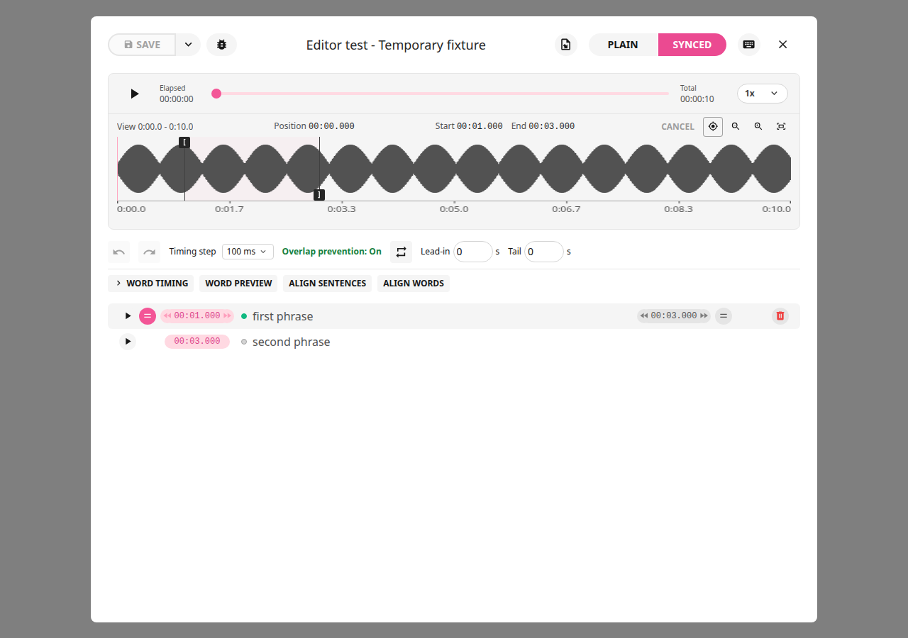
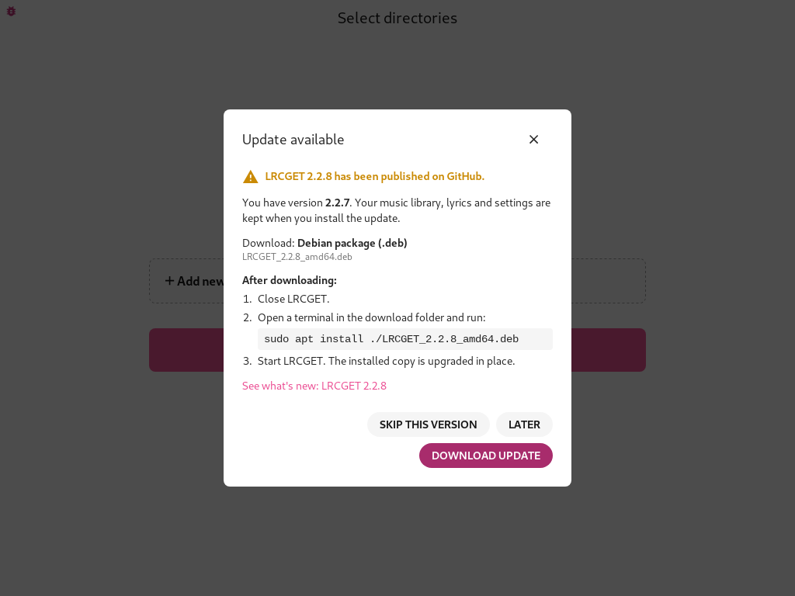
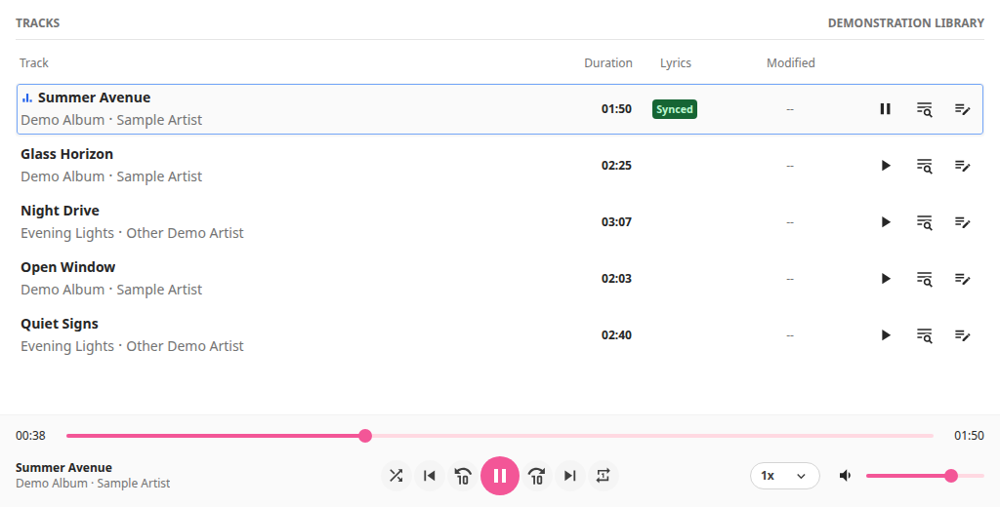
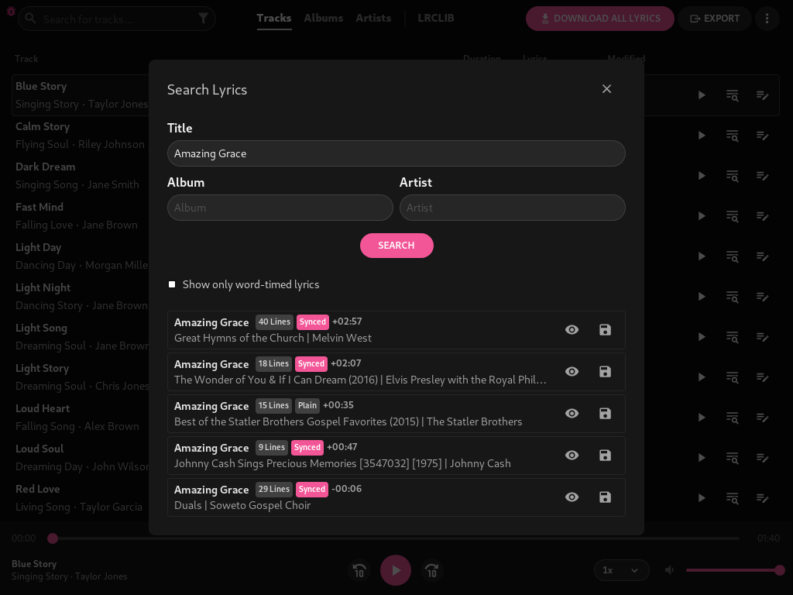
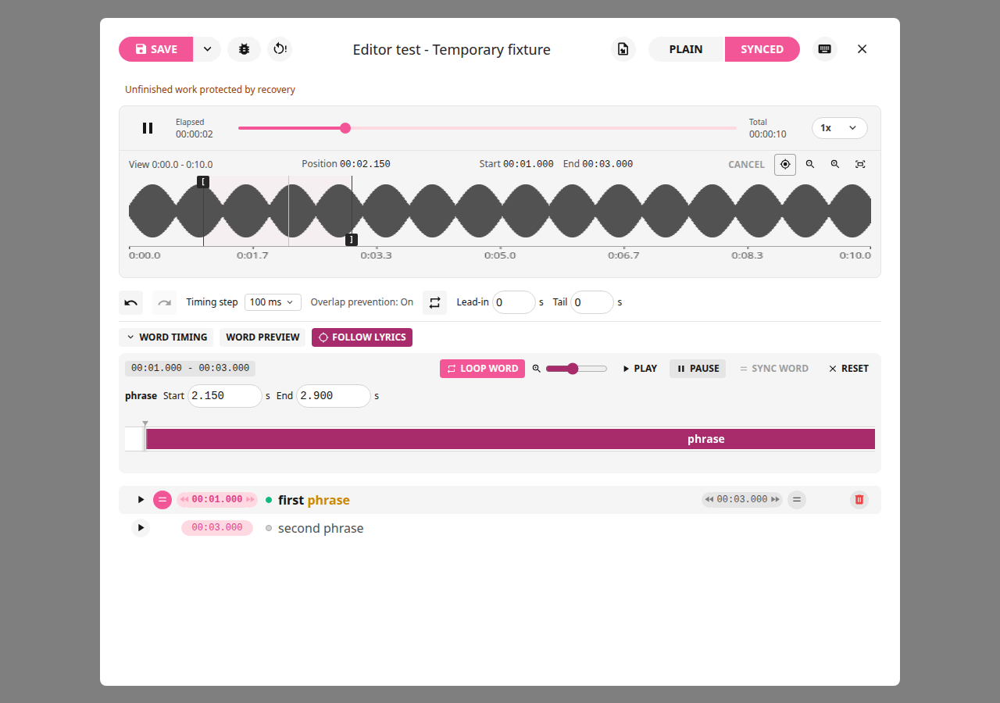
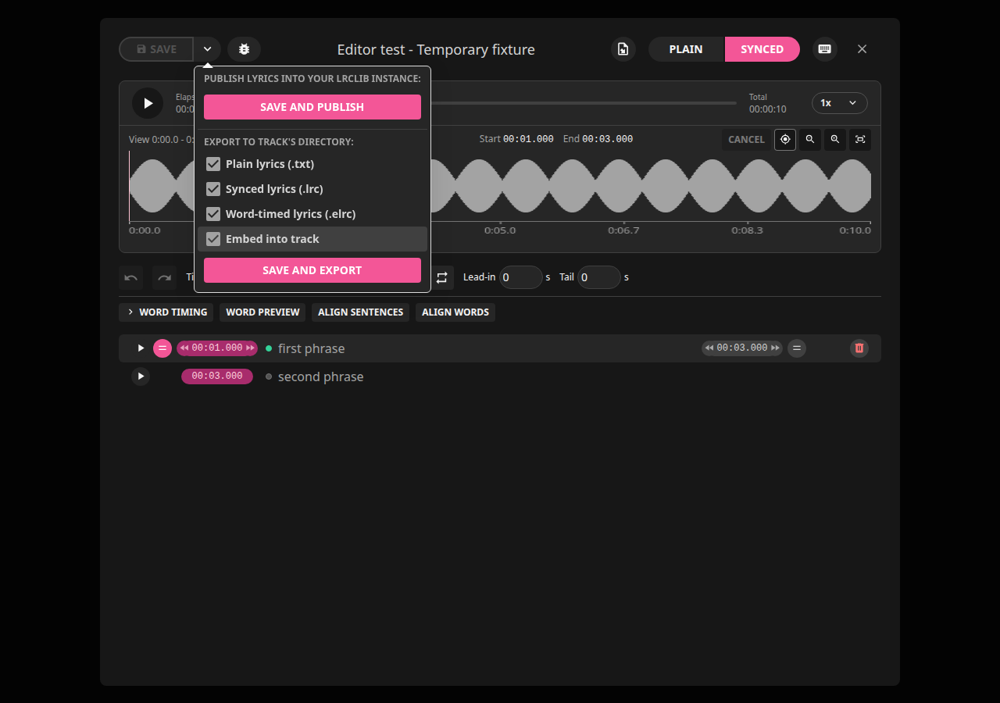

# LRCGET — Rick Lidgett's Enhanced Lyrics Editor

A desktop app for downloading, creating and precisely timing synced lyrics for
your offline music library. It is an independent, MIT-licensed fork of
[LRCGET](https://github.com/tranxuanthang/lrcget) by tranxuanthang, adding a
waveform lyrics editor, word-by-word timing, Enhanced LRC (`.elrc`) and update
alerts. See [What this fork changes](#what-this-fork-changes) and
[License and attribution](#license-and-attribution).

**[Download the latest release](https://github.com/scriptusscript777/lrcget/releases/latest)** ·
[Illustrated how-tos](docs/how-to.md) · [Changelog](CHANGELOG.md) ·
[Report a problem](https://github.com/scriptusscript777/lrcget/issues)



## Supported systems

| System                                                              | Installer | Processor              |
| ------------------------------------------------------------------- | --------- | ---------------------- |
| Windows 10 and 11                                                   | `.msi`    | x64 (64-bit Intel/AMD) |
| Linux Mint 22, Ubuntu 24.04, Debian-based systems with glibc 2.39+  | `.deb`    | x64 (amd64)            |
| Other Linux distributions with glibc 2.39+, GTK 3 and WebKitGTK 4.1 | AppImage  | x64                    |

Desktop and laptop computers only. The editor needs a window of at least
1024 × 768 and is designed for a mouse and keyboard. **Not supported:** phones,
tablets, Chromebooks, macOS, ARM computers (no ARM64 builds are published) and
older Linux releases.

## Download

Each [release](https://github.com/scriptusscript777/lrcget/releases/latest) contains:

| File                                            | Use                                                            |
| ----------------------------------------------- | -------------------------------------------------------------- |
| `LRCGET_<version>_x64_en-US.msi`                | Windows 10/11 installer                                        |
| `LRCGET_<version>_amd64.deb`                    | Linux Mint / Ubuntu / Debian package                           |
| `LRCGET_<version>_amd64.AppImage`               | Portable Linux app                                             |
| `LRCGET_<version>_source.zip` / `.tar.gz`       | Full source code with documentation                            |
| `LRCGET_<version>_docs.zip`                     | Illustrated guides on their own                                |
| `LRCGET_<version>_THIRD_PARTY_NOTICES.md`       | Licenses of the bundled open-source components                 |
| `LRCGET_<version>_AppImage_library_sources.tar` | Source code of the Linux libraries bundled inside the AppImage |
| `*.sha256`, `LRCGET_<version>_SHA256SUMS.txt`   | Checksums to verify downloads                                  |

Every installer is built and tested by GitHub Actions before it is published,
including installing over the previous release and uninstalling.

## Install

Your music library, lyrics and settings are kept when you install a newer
version over an older one. Optionally verify a download first: on Linux run
`sha256sum -c FILE.sha256`; on Windows compare `Get-FileHash FILE` with the
`.sha256` file.

### Windows 10/11 (`.msi`)

1. Download the `.msi` file and double-click it.
2. This MSI has no digital publisher signature, so Windows cannot verify its
   publisher and may show an unknown-publisher or SmartScreen warning. This is a
   new independent fork with limited public recognition, so it does not yet
   qualify for a sponsored signing certificate. The warning alone does not mean
   malware. Install only if you downloaded it from the LRCGET fork's official
   GitHub release and its SHA-256 matches the published checksum. Windows CI scans
   reported no threats, though scans cannot guarantee a file is risk-free or
   prevent Windows from warning.
3. Follow the installer. Installing a newer version replaces the old one.

Uninstall from **Settings → Apps → Installed apps → LRCGET**. If WebView2 is
missing, the installer downloads it from Microsoft.

### Linux Mint, Ubuntu, Debian (`.deb`)

1. Close LRCGET if it is running.
2. Open a terminal in the download folder and run (use the actual file name):

   ```bash
   sudo apt install ./LRCGET_2.2.7_amd64.deb
   ```

3. Start LRCGET from the application menu. A newer `.deb` upgrades the installed
   copy in place. To reinstall the same version, add `--reinstall`.

Uninstall with `sudo apt remove lrcget`. Your lyrics database is kept in
`~/.local/share/net.lrclib.lrcget`.

### Other Linux (AppImage)

1. Make the file runnable: right-click it, choose **Properties → Permissions**
   and turn on **Allow executing file as program**, or run
   `chmod +x LRCGET_2.2.7_amd64.AppImage`.
2. Double-click it to start. If it reports missing FUSE, install `libfuse2`
   (`libfuse2t64` on Ubuntu 24.04) or run it with `--appimage-extract-and-run`.
3. To update, replace the old AppImage file with the new one.

The AppImage and the `.deb` share the same settings; run one at a time. More
detail: [package guide](docs/packages.md).

## Update alerts

Each time LRCGET starts, it asks GitHub once whether a newer version has been
published. If so, an **Update available** window shows the new version and the
one installer that matches your computer, with install steps.



- **Download update** opens the download in your browser. LRCGET never installs
  or runs anything by itself.
- **Later** reminds you at the next start; **Skip this version** hides that version.
- Without an internet connection the check stays silent. Open **About** to check
  by hand. Details: [how-to](docs/how-to.md#get-notified-about-new-releases) and
  [privacy](docs/privacy.md#automatic-update-check).

## Features

- **Library:** scan your music folders, browse tracks, albums and artists, see
  which songs have synced, plain or no lyrics, and refresh with F5.
- **Find lyrics online:** search [LRCLIB](https://lrclib.net), compare durations,
  preview and apply results, or download lyrics for the whole library.
- **Waveform editor:** click-to-play waveform with zoom, precise Start/End
  markers, previews, Cancel, Undo/Redo and overlap protection.
- **Word timing:** time every word, loop a word or sentence while refining it,
  and save Enhanced LRC (`.elrc`) with word timestamps.
- **Import and export:** plain TXT, standard LRC and ELRC chosen independently;
  optional embedding in MP3 (USLT/SYLT/TXXX) and FLAC.
- **Optional audio alignment:** local Whisper/stable-ts alignment of sentences or
  words, installed only with your consent. Basic editing needs no AI.
- **Safety:** unfinished work is recovered automatically; publishing to LRCLIB
  always asks for confirmation.
- **Themes and help:** light and dark themes, optional hover help, F1 help and
  configurable shortcuts.

Full list: [features](docs/features.md).

## Screenshots

|                                                                                 |                                                                                    |
| ------------------------------------------------------------------------------- | ---------------------------------------------------------------------------------- |
|                |            |
|  |  |

More pictures in the [illustrated overview](docs/app-overview.md) and
[how-tos](docs/how-to.md). Screenshots use generated demonstration music.

## Documentation

- [Step-by-step how-tos](docs/how-to.md) and [editing reference](docs/editing-guide.md)
- [Package installation and verification](docs/packages.md)
- [Troubleshooting](docs/troubleshooting.md) and [recovery](docs/recovery.md)
- [Optional audio alignment](docs/audio-alignment.md)
- [Privacy and network use](docs/privacy.md)
- [Building from source](docs/build-from-source.md), [developer guide](docs/developer-guide.md)
  and [platform builds](docs/platform-builds.md)
- [Changelog](CHANGELOG.md) and [detailed release notes](docs/releases/)

## Known limitations

- Windows installer is not code-signed yet, so SmartScreen shows a warning.
- x64 only; no macOS, ARM, RPM or Flatpak builds of this fork.
- Linux packages need glibc 2.39 or newer (Mint 22 / Ubuntu 24.04 or newer).
- Estimated and automatically aligned timing needs listening review; singing
  alignment is not perfect.
- Plain TXT stores no timing; LRC stores sentence timing; ELRC stores word timing.
  Word highlighting depends on the player you use.
- Same-version maintenance builds do not trigger update alerts; only a higher
  version does.

## Report a problem

Open an [issue](https://github.com/scriptusscript777/lrcget/issues) with your
system, LRCGET version (shown in **About**) and steps to reproduce. Issues are
public: leave out personal paths, private lyrics, audio and email addresses.

## Troubleshooting

- **No audio on Linux:** install `pipewire-alsa` (`sudo apt install pipewire-alsa`).
- **App won't open on Windows:** install Microsoft Edge WebView2 if it was removed
  (for example on LTSC or "debloated" systems).
- **Invisible scrollbar on KDE Plasma:** System Settings → Appearance → Global
  Theme → Application Style → Configure GNOME/GTK Application Style, choose a
  different GTK theme.

More in [troubleshooting](docs/troubleshooting.md).

## Building from source

Requires Node.js 22, stable Rust and the
[Tauri prerequisites](https://v2.tauri.app/start/prerequisites/) for your system.

```bash
npm ci
npm run tauri dev                                 # development window
npm run tauri -- build --bundles deb,appimage    # Linux packages
```

The Windows MSI is built with `packaging/windows/build-msi.ps1`. Full
instructions: [build from source](docs/build-from-source.md).

**Releases (maintainers):** commit the version, `CHANGELOG.md` and
`docs/releases/<version>.md`, then run **Actions → Release installers** with a
tag such as `v2.2.8`. It runs the Windows (`windows-msi.yml`) and Linux
(`linux-packages.yml`) build and install checks and publishes only if all of
them pass.

## What this fork changes

This fork keeps the original LRCGET library scanner, LRCLIB downloader and
publisher, and adds the lyrics editor and packaging work described above.
Modified and added files are recorded in the Git history; summaries are in
[CHANGELOG.md](CHANGELOG.md), [LOCAL_CHANGES.md](LOCAL_CHANGES.md) and
[docs/releases](docs/releases/). The app keeps the original identifier
`net.lrclib.lrcget`. This is not an official LRCGET release, and the original
author does not endorse or support it.

## License and attribution

LRCGET is © 2023 tranxuanthang and is distributed under the
[MIT License](LICENSE); the original copyright and permission notice are kept
unchanged and must be included in copies or substantial portions of the
software. Modifications are by Rick Lidgett
([@scriptusscript777](https://github.com/scriptusscript777)) under the same
license. Third-party libraries keep their own licenses; see
[THIRD_PARTY_NOTICES.md](THIRD_PARTY_NOTICES.md).

## Original project

[LRCGET](https://github.com/tranxuanthang/lrcget) scans your music folders and
downloads matching LRC lyrics from [LRCLIB](https://lrclib.net), saving them
next to your music files. LRCGET is the official client of the LRCLIB service.
For the original app on all platforms (including Flatpak, RPM and macOS), see the
[upstream releases](https://github.com/tranxuanthang/lrcget/releases).

Support the original developer:
[GitHub Sponsors](https://github.com/sponsors/tranxuanthang) ·
[Buy Me a Coffee](https://www.buymeacoffee.com/thangtran) ·
[PayPal](https://paypal.me/tranxuanthang98) ·
Monero `43ZN5qDdGQhPGthFnngD8rjCHYLsEFBcyJjDC1GPZzVxWSfT8R48QCLNGyy6Z9LvatF5j8kSgv23DgJpixJg8bnmMnKm3b7` ·
Litecoin `ltc1q7texq5qsp59gclqlwf6asrqmhm98gruvz94a48`.
Original author contact: [hoangtudevops@protonmail.com](mailto:hoangtudevops@protonmail.com)
(for the original project, not this fork).
