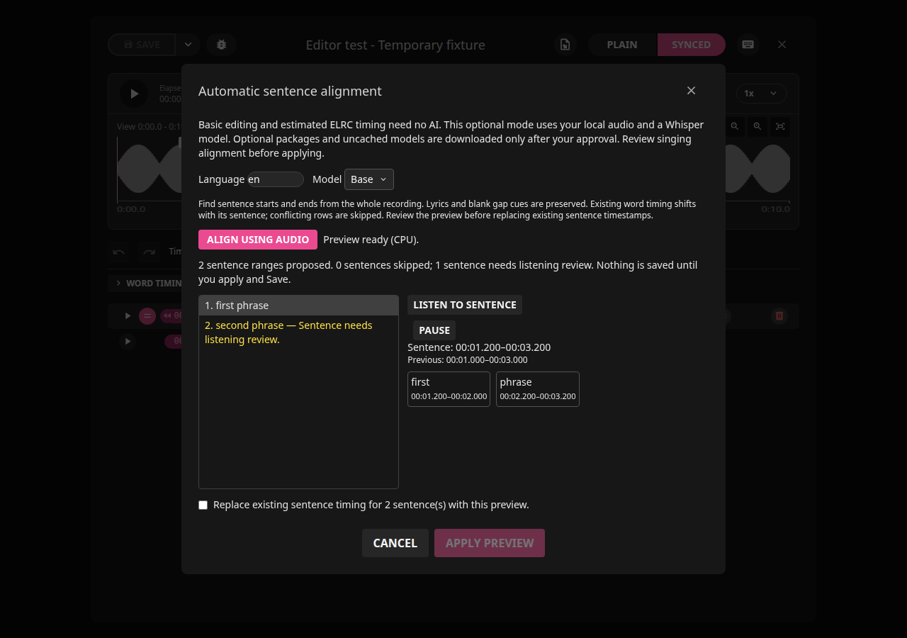

# LRCGET — Rick Lidgett's Enhanced Build

An independent MIT-licensed fork of [LRCGET](https://github.com/tranxuanthang/lrcget),
maintained by [Rick Lidgett](https://github.com/scriptusscript777). Original authors,
copyright notices and license remain credited. Application version stays **2.2.7**.

## Supported systems

Desktop and laptop computers only: Linux x64 (Debian package or AppImage; Mint 22 /
Ubuntu 24.04 or newer) and Windows 10/11 x64 (MSI). The editor needs a window at
least 1024 × 768 and is designed for a mouse and keyboard. Phones, tablets,
Chromebooks, macOS and ARM computers are not supported; there is no mobile version.

## Downloads and installation

[Current 2.2.7 release](https://github.com/scriptusscript777/lrcget/releases/tag/v2.2.7-windows-beta.1) includes Linux Debian amd64, Linux AppImage x64,
and an unsigned Windows x64 MSI beta, each with a SHA256 checksum. Source ZIP and
tar.gz archives include the code, illustrated documentation and build scripts.

| Package | Install or run | Compatibility |
| --- | --- | --- |
| [Debian](https://github.com/scriptusscript777/lrcget/releases/download/v2.2.7-windows-beta.1/LRCGET_2.2.7_amd64.deb) | `sudo apt install ./LRCGET_2.2.7_amd64.deb` | Mint 22 / Ubuntu 24.04 baseline, glibc 2.39+; upgrades package `lrcget` |
| [AppImage](https://github.com/scriptusscript777/lrcget/releases/download/v2.2.7-windows-beta.1/LRCGET_2.2.7_amd64.AppImage) | `chmod +x LRCGET_2.2.7_amd64.AppImage`, then run it | Linux x64, glibc 2.39+; FUSE 2 or `--appimage-extract-and-run` |
| [Windows MSI beta](https://github.com/scriptusscript777/lrcget/releases/download/v2.2.7-windows-beta.1/LRCGET_2.2.7_x64_en-US.msi) | Open the MSI and follow installation prompts | Windows x64; WebView2; unsigned, Windows Server CI tested |

Already using Debian version 2.2.7? Close LRCGET and use
`sudo apt install --reinstall ./LRCGET_2.2.7_amd64.deb` for this maintenance build.
AppImage and Debian use the same profile; run one version at a time.
Windows 11 interactive playback, optional engine setup and older-version upgrades
still need desktop testing. See [package instructions and checks](docs/packages.md)
and [platform limitations](docs/platform-builds.md). No current macOS/RPM/ARM fork
packages are provided. Historical upstream downloads below are separate releases.

## Features and illustrated how-tos

- Download lyrics from the configured LRCLIB-compatible server; recognize actual
  word timing and fall back to ordinary LRC/TXT according to selected filters.
- Import/edit plain TXT, sentence-timed LRC and word-timed ELRC; startup/F5 checks
  matching ELRC before LRC/TXT for eligible unedited tracks.
- Click-to-play waveform, stable playhead while zooming, precise Start/End marker
  previews, Cancel, Undo/Redo and theme-aware overlap protection.
- Timing-only word boxes, gray disabled Sync after confirmation, independent
  word zoom, Pause/Resume, persistent word/sentence loops and live Word preview.
- Basic manual editing and estimated words need no AI. Optional local
  **Align sentences** and **Align words** use consented Whisper/stable-ts models;
  listen to proposals before applying. Missing engine setup asks once, with an
  Install button for later and separate verified model-download consent.
- Save unfinished-work recovery separately from exports; successful saves clean
  only the current completed draft. Reset words affects one sentence; no master reset.
- Select TXT, LRC, ELRC and supported MP3/FLAC embedding independently. ELRC can
  preserve existing edited words and explicitly accepted missing estimates.
  MP3 supports USLT, SYLT and optional TXXX Enhanced LRC text.
- Hover help is off by default; Configuration enables it, F1 requests it explicitly.

Start with the [documentation index](docs/README.md), [complete features](docs/features.md),
[step-by-step how-tos](docs/how-to.md), [editing reference](docs/editing-guide.md),
[automatic alignment guide](docs/audio-alignment.md), [recovery guide](docs/recovery.md),
[troubleshooting](docs/troubleshooting.md), [source/build guide](docs/build-from-source.md)
and [developer guide](docs/developer-guide.md).

## Current interface





Images show the actual Vue interface using isolated demonstration lyrics and mocked
native commands; packaged Linux startup is tested separately. See the
[capture index](docs/screenshots/current/README.md) for dates and provenance.
Screenshots do not demonstrate guaranteed singing accuracy.

## Validation and limitations

Linux: 558 frontend tests, 88 native tests (two optional fixtures ignored), 18
Python tests, Ruff, scoped ESLint, Cargo check and MSI configuration tests passed.
Debian and AppImage opened successfully under isolated Xvfb profiles.
[Windows CI](https://github.com/scriptusscript777/lrcget/actions/runs/38296288986)
passed 558 frontend/86 native tests, optional setup tests, MSI identity/checksum,
Defender installer/payload scans, install, repair, visible launch and uninstall.
Windows scans found no threats; they do not establish SmartScreen reputation.
See the [detailed review](docs/reviews/2.2.7.md) and [release notes](docs/releases/2.2.7.md).

Models and estimated timing require listening review. Plain TXT cannot store
sentence/word timing; LRC stores sentence timing, ELRC stores inline word timing.
Player support varies. Local exports do not publish to a server; publishing sends
lyrics/metadata only when requested. See [privacy](docs/privacy.md).

## Code signing policy

Current packages are unsigned. SignPath Foundation application/approval is pending;
no Foundation signature or sponsorship is claimed. See [code signing policy and
setup](docs/code-signing.md). Upstream signing status has not been verified.

## Original Project

LRCGET will scan every files in your chosen directory for music files, then and try to download lyrics to a LRC files having the same name and save them to the same directory as your music files.

LRCGET is the official client of [LRCLIB](https://lrclib.net) service.

## Upstream Downloads

The historical links below are upstream v2.1.0 downloads, not Rick Lidgett's
enhanced build. Visit the [upstream release page](https://github.com/tranxuanthang/lrcget/releases)
for upstream versions and other platforms.

### Windows

EXE installer (recommended): [LRCGET_2.1.0_x64-setup.exe](https://github.com/tranxuanthang/lrcget/releases/download/2.1.0/LRCGET_2.1.0_x64-setup.exe)

MSI installer: [LRCGET_2.1.0_x64_en-US.msi](https://github.com/tranxuanthang/lrcget/releases/download/2.1.0/LRCGET_2.1.0_x64_en-US.msi)

### Linux

Flatpak build (recommended, for most Linux distros):

<a href='https://flathub.org/en/apps/net.lrclib.lrcget'></a>

Deb packages (for Ubuntu 24.04+ and Linux Mint 22+): [LRCGET_2.1.0_amd64.deb](https://github.com/tranxuanthang/lrcget/releases/download/2.1.0/LRCGET_2.1.0_amd64.deb)

RPM packages (for Fedora, openSUSE, etc.): [LRCGET-2.1.0-1.x86_64.rpm](https://github.com/tranxuanthang/lrcget/releases/download/2.1.0/LRCGET-2.1.0-1.x86_64.rpm)

AppImage (for most Linux distros): [LRCGET_2.1.0_amd64.AppImage](https://github.com/tranxuanthang/lrcget/releases/download/2.1.0/LRCGET_2.1.0_amd64.AppImage)

### macOS

Mac x64 (Intel): [LRCGET_2.1.0_x64.dmg](https://github.com/tranxuanthang/lrcget/releases/download/2.1.0/LRCGET_2.1.0_x64.dmg)

Mac Apple Silicon: [LRCGET_2.1.0_aarch64.dmg](https://github.com/tranxuanthang/lrcget/releases/download/2.1.0/LRCGET_2.1.0_aarch64.dmg)

## Historical Upstream Screenshots

These images show an older upstream interface, not this fork's current editor.

<details>
<summary>View original upstream screenshots</summary>


</details>

## Donation

Toss a coin to your developer?

**GitHub Sponsors (Recommended - 100% of your support goes to the developer):**

https://github.com/sponsors/tranxuanthang

**Buy Me a Coffee:**

https://www.buymeacoffee.com/thangtran

**Paypal:**

https://paypal.me/tranxuanthang98

**Monero (XMR):**

```
43ZN5qDdGQhPGthFnngD8rjCHYLsEFBcyJjDC1GPZzVxWSfT8R48QCLNGyy6Z9LvatF5j8kSgv23DgJpixJg8bnmMnKm3b7
```

**Litecoin (LTC):**

```
ltc1q7texq5qsp59gclqlwf6asrqmhm98gruvz94a48
```

## Troubleshooting

**Audio cannot be played in Linux (Ubuntu and other distros)**

Try to install `pipewire-alsa` package. For example, in Ubuntu or Debian-based distros:

```
sudo apt install pipewire-alsa
```

**App won't open in Windows 10/11**

If you are using Windows 10 LTSC, or have tried running some scripts to debloat Windows 10 (which will uninstall Microsoft Edge and its webview component), you might have issues as LRCGET depends on WebView2. Reinstalling Microsoft Edge might fix the problem (see issue https://github.com/tranxuanthang/lrcget/issues/45).

**Scrollbar is invisible in Linux (KDE Plasma 5/6)**

The exact cause is still unknown, but it can be fixed by going to System Settings > Appearance > Global Theme > Application Style > Configure GNOME/GTK Application Style... > Change to something other than breeze (Awaita or Default) > Apply (see comment https://github.com/tranxuanthang/lrcget/issues/44#issuecomment-1962998268)

## Contact

If you prefer to contact by email:

[hoangtudevops@protonmail.com](mailto:hoangtudevops@protonmail.com)

## Development

LRCGET is made with [Tauri](https://tauri.app).

To start developing the application, you need to do the [prerequisites](https://v2.tauri.app/start/prerequisites/) steps according to your operating system.

For example, you need the following components to start the development in Windows:

- Microsoft Visual Studio C++ Build Tools
- Stable Rust with the MSVC target
- Node.js 22

Start the development window with the following command:

```shell
cd lrcget
npm install
npm run tauri dev
```

## Building

Start the build process with the following command:

```shell
cd lrcget
npm install
npm run tauri build
```

Your built binaries are located at:

```
./src-tauri/target/release/
```

For more detailed instruction, follow the [building guide](https://v2.tauri.app/distribute/) to build the application according to your OS platform.

Hover help is off by default. In **Configuration**, enable **Show hover help**
and Save if you want automatic descriptions. Your choice survives restarting.
F1 shows help for a hovered or focused control either way; it closes after two
seconds. Help never blocks waveform editing or playback controls.

Linux compatibility: the shared hover-help behavior is independent of desktop
environment. This amd64 installer requires glibc 2.39 or newer, GTK 3 and
WebKitGTK 4.1 (such as Ubuntu 24.04 / Mint 22 or compatible newer systems).
Older Debian-based releases and ARM need a build for their platform; a `.deb`
extension alone does not guarantee binary compatibility.

Loop now remains enabled when selecting or playing another lyric. Its range moves
to the selected markers; turn Loop off explicitly for continuous playback.
See the [loop how-to](docs/how-to.md#loop-between-the-markers).

See the [complete feature index](docs/features.md), [troubleshooting](docs/troubleshooting.md),
and [package/source guide](docs/packages.md). The manual Windows MSI build is in
[Windows packaging](packaging/windows/README.md).

## Automatic unfinished-work recovery

Unfinished lyrics are protected separately from normal saves and exports.
Reopen the song or use Resume editing to recover it. Successful Save cleans
only that project's completed draft; newer edits and pending markers remain.
Word timing warnings now use yellow text. See the [recovery guide](docs/recovery.md)
for restoration, conflicts, cleanup and limitations.

## Restart one sentence’s word timing

Use **Reset words** to clear only the selected sentence’s word timing and
regenerate evenly spaced estimates. Text and sentence markers stay in place;
Undo restores the prior word timings. Master reset has been removed.

Word preview matches live sentence-row highlighting; the recovery notice leaves
space beside the main debug icon. See the [editing guide](docs/editing-guide.md).

Native-loop maintenance (version unchanged): word/sentence repeats run inside
the audio engine with approximately 10 ms cursor updates during loops. Live
waveform preview ranges, word edits, Pause/Resume and context remain supported.
Ordered backend sessions reject stale commands/cleanup from older editors.
See [editing guide](docs/editing-guide.md) for listening and latency details.

Word-editing maintenance (version remains 2.2.7): Follow Lyrics holds both word
views when off, independent manual adjustments retain confirmed ranges on Sync,
confirmed words stay gray until changed, and Reset words restarts one sentence’s
word timing with Undo support. Overlap status is green On/red Off in both themes.
Master reset is removed; recovery and TXT/LRC/ELRC Save/import/export remain.

## ELRC save with accepted estimates (version unchanged)

Editor **Save and export** with ELRC selected offers to fill missing word starts
after showing the number of affected sentences. Existing manual times, word gaps
and lyric text stay unchanged. Users may adjust some words and leave others alone.
Accepted estimates persist in the project and ELRC, with Undo support; Cancel does
not save or export. Untimed text must receive sentence timing first. Invalid saved
word data, too-short ranges and protected overlaps block preparation. Plain TXT
and standard LRC export alone do not estimate words. Library batch export and
server publishing retain their saved-data behavior. The green dot indicates valid
word timing, including accepted estimates, rather than manual verification.

See [illustrated export instructions](docs/editing-guide.md#export-word-timing-as-enhanced-lrc).


### ELRC discovery and library status

Startup/F5 now reads valid matching `.elrc` before `.lrc`; missing lyrics fall
back to `.txt`. Untouched ordinary LRC can upgrade to real word timing. Existing
word timing, instrumental lyrics and explicit editor saves remain protected.
Invalid ELRC falls back safely; scans never change audio or sidecars and do not
mark imported lyrics Modified. Valid user/server ELRC appears **Synced**; untimed
sentence-editing rows remain **Plain**. Downloads honor the chosen filter and
automatic export formats; downloads never silently generate estimated word times.


## Basic and optional Automatic audio alignment

Basic TXT/LRC/ELRC editing, estimated word timing and manual synchronization
remain available without AI. **Align words** in the editor header opens optional
local audio alignment with language/model selection, progress and cancellation.
Preview yellow uncertain words, listen, then Apply in one Undo step. Existing
word times are protected unless explicitly replaced; sentence bounds and text
remain intact. Complete applied timing saves ELRC without another estimate prompt.
See the [illustrated audio alignment guide](docs/audio-alignment.md) for setup and
limitations. Singing alignment requires review; confidence is only a hint.

Optional audio setup now asks once when the engine is unavailable; declining
keeps an Install button for later. Each missing model needs separate approval.
Synced toolbar order is Word preview → Align sentences → Align words; model choices remain
readable in light/dark themes. Basic editing needs no AI. See [the illustrated setup guide](docs/audio-alignment.md).
