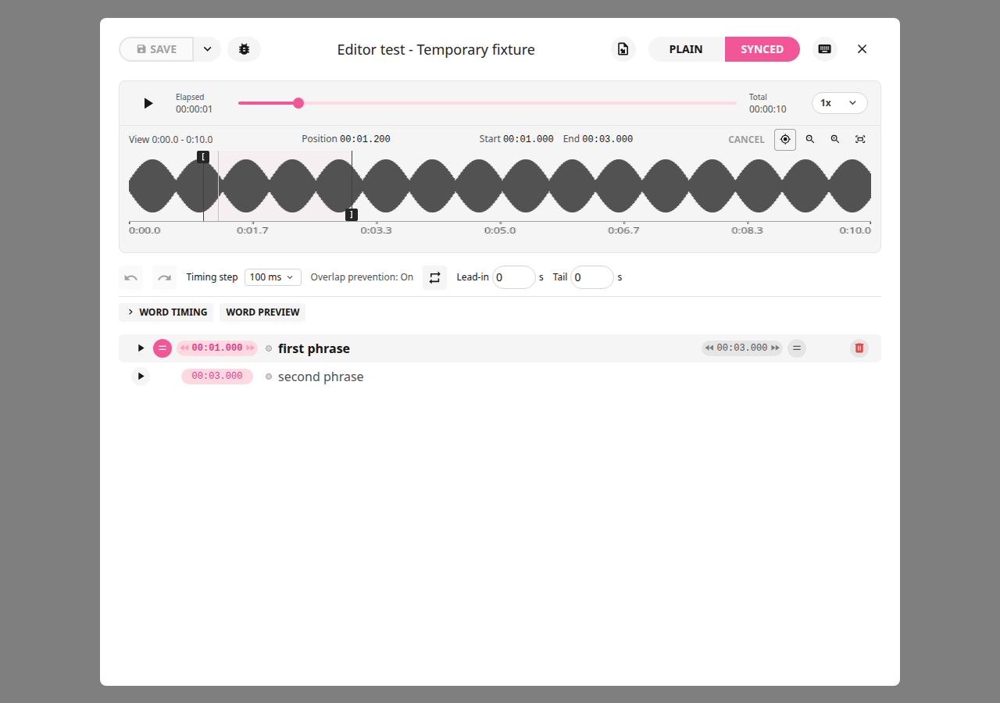
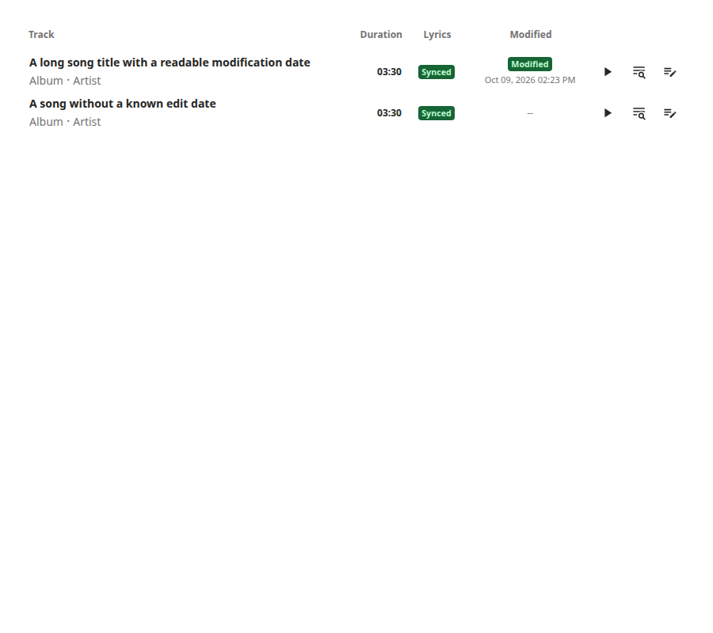

# App Overview and Modifications

**Version:** 2.2.6+local.10. **Editing developer:** Rick Lidgett
([@scriptusscript777](https://github.com/scriptusscript777)).
This is an independent LRCGET fork, not an official upstream release.
The original project retains its credits and license.

[Documentation home](README.md) | [Practical how-tos](how-to.md) | [Detailed reference](editing-guide.md)

## What the App Does

LRCGET scans your music directories and searches LRCLIB for plain or timed
lyrics. Its editor lets you correct wording and manually place line/word
timestamps against the actual recording. Save retains the editor document;
export writes local files or supported audio tags; publish shares lyrics online.

The enhanced editor keeps basic line editing visible and puts individual-word
tools in a collapsible **Word timing** section. Light and dark themes cover
timing controls, waveform navigation and export options.



## Library and Modified Dates

- Opening an initialized library runs an incremental scan. **F5** and the
  library's **Refresh library (F5)** action discover added/removed recordings.
- The **Modified** column sits after Lyrics and before action buttons. Its
  green badge shows the last explicit editor-save date/time in the PC's timezone.
- Opening a track or saving without changes does not create a modification date.
  A downloaded/imported lyric is not a human edit until explicitly saved in the editor.
- Dates survive embedding, restart and refresh. Scans keep the same track record
  when tag exports change an audio file's fingerprint at the same path.
- Matching dates orphaned by older scans can be recovered without replacing
  current lyric content. Ambiguous matches are left alone; unknown dates show `--`.
- Removing a recording removes its library row on refresh. Existing preservation
  of orphaned lyric documents is separate from the visible library listing.



## Inputs and Working Documents

| Input                       | How It Is Used                                                                                |
| --------------------------- | --------------------------------------------------------------------------------------------- |
| Untimed `.txt`              | Imported as plain text and untimed rows; you assign timestamps                                |
| Line-timed `.txt` or `.lrc` | Existing line timestamps become editable rows                                                 |
| LRCLIB result               | Select the matching recording; plain results still need timing                                |
| Genius or another website   | Copy sung lyrics into Plain or a TXT file; arbitrary URLs are not scraped                     |
| Embedded audio lyrics       | Supported by the library import/embedding workflow; explicit file import loads external edits |

Import replacement requires confirmation. It changes the working document,
not the source file. Plain and Synced are separate working versions: editing
synced wording does not silently rewrite your Plain text or original TXT.
File import is replacement, not automatic merging of two lyric versions.

Line-level timestamp formats include `[mm:ss.xx]` and milliseconds. Enhanced
inline word-tag LRC and nonzero offset headers need conversion to explicit
line timestamps before file import. Mixed timed/untimed files are rejected.


## Waveform, Zoom and Markers

- The waveform shows the whole mix, not a separated singer. It is decoded and
  cached; normal zooming/playback does not repeatedly analyze the recording.
- Click to start playback from that point, including when paused. Use zoom buttons
  or repeated double-clicks for magnification; Play resumes the current position.
  Wheel/trackpad gestures and the bottom pan control reach off-screen regions.
- **Follow waveform playback** keeps the playhead visible at the selected zoom,
  with Loop on or off. Zoom preserves Follow. Manual panning holds the inspected
  region; pause/play or the Follow button resumes automatic navigation.
- **Start / End** show exact marker times with milliseconds above the waveform,
  including off-screen markers. Moving a handle updates the row; **Preview**
  identifies unconfirmed timing edits. Cancel restores the saved pair.
- An explicit Follow-off choice remains off across zoom and playback restarts.
- The clock displays `mm:ss.mmm`, but player updates are approximately every
  40 ms. Display precision is not a promise of millisecond playback accuracy.
- Time labels distinguish **Elapsed / Total** recording clocks, the precise
  **Position** playhead, the **View** range, and selected lyric **Start / End**.
- Start/end handles each use one vertical guide and separate upper/lower hit
  areas, so close markers remain selectable.
- A subtle tint between the markers shows the selected phrase, follows marker
  previews, and clips at the viewport edges without blocking clicks or handles.
- Dragging/nudging creates a preview, not a saved edit. **Sync Sentence Start** and **Sync Sentence End** confirm
  their corresponding moved markers as independent undoable edits. **Cancel** restores the last confirmed timing.
- Crossing a neighboring lyric boundary shows a warning with the distance in
  seconds, including zoomed/off-screen previews. **Prevent overlapping lyrics**
  blocks confirmation by default; turn it off for deliberate overlaps.
  Existing neighboring timestamps are preserved by marker edits.


## Loops and Playback

**Loop selected phrase** repeats the selected range. Lead-in and Tail add audition
context; both default to zero for exact marker-to-marker repetition. Released
marker previews become the audition range before confirmation. Dragging does
not continuously reseek. Sentence Sync confirms timestamps; Cancel restores saved bounds.

Normal playback can pass the end marker. A sentence's Play button selects that
phrase and retains an enabled Loop. Changing lyric selection moves the loop to
the new markers. Turn Loop off for forward playback. Untimed selections and
inactive tabs suspend repetition without losing the mode.

## Lines and Individual Words

Line starts/ends can be synchronized to playback, entered or nudged. Timing steps
include 10/25/50/100 ms. Undo/Redo operates on synced edits during the session.
Untimed text has no confirmed markers until a start is set; its provisional end
is labeled **Inferred end** until you confirm one.

**Follow Lyrics** is different from waveform Follow: it advances the selected
lyric/word boxes and marker targets, without rewriting timestamps. Manual
selection, loops, word editing and marker previews hold the selected target.

Word tools provide separate lane zoom, divider dragging, safe playback Sync and
precise Start/End fields. Word text is read-only: edit wording in the sentence
row. Released drags apply directly and leave both sentence markers fixed. The
next Sync word retains a manual adjustment; other Sync actions reject playback
outside neighboring-word bounds instead of compressing or moving other words.


## Save, Export and Publish

| Action                 | Destination                                      | Shared Online? |
| ---------------------- | ------------------------------------------------ | -------------- |
| Save                   | LRCGET's local lyric document                    | No             |
| Save and export: TXT   | Plain sidecar beside the recording               | No             |
| Save and export: LRC   | Timed sidecar beside the recording               | No             |
| Save and export: ELRC  | Optional word-timed sidecar beside the recording | No             |
| Save and export: Embed | Supported MP3/FLAC metadata                      | No             |
| Save and Publish       | Configured LRCLIB instance, after confirmation   | Yes            |

LRC export is initially selected in the editor. Embedding requires the saved
setting and a supported file. MP3 output uses ID3v2.4 UTF-8 USLT/SYLT; timed
entries use milliseconds. Audio is not re-encoded. FLAC uses its metadata fields.
Embedding is not guaranteed to display in older cars, Windows players or every
Jellyfin client. Keep an LRC sidecar when useful for your playback software.

TXT and LRC exports coexist. Selecting a format can replace its existing
destination; leaving TXT unchecked protects an existing TXT from that export.
Unconfirmed waveform previews are not exported. Confirm them with the sentence Sync buttons first.

Exports stage/check output and then replace the destination atomically. Failed
preparation leaves the original intact. Since .20, successful exports create no
rolling `.bak` files and clean the exact destination's old `.lrcget.bak`, when
removal is permitted. Unrelated backups are untouched. Keep separate backups
if you need version history. Failure for one target can leave other targets
successfully exported; inspect the result before retrying.


## Modification Map

| Enhancement         | What Changed                                                                                      | Reference                                                                      |
| ------------------- | ------------------------------------------------------------------------------------------------- | ------------------------------------------------------------------------------ |
| Embedded lyrics     | Optional MP3/FLAC export, replacement of older lyric variants, metadata/audio preservation checks | [Export reference](editing-guide.md#save-export-and-publish)                   |
| File import         | Plain TXT, timestamped TXT and LRC with confirmation and source protection                        | [Import how-to](how-to.md#create-timed-lyrics-from-a-text-file)                |
| Timing editor       | Line/word tools, steps, contextual playback, keyboard handling and session undo                   | [Editing reference](editing-guide.md#edit-lines-and-text)                      |
| Waveform navigation | Cached peaks, seek, zoom, pan and playback following                                              | [Waveform how-to](how-to.md#zoom-and-follow-without-looping)                   |
| Marker confirmation | Live preview, sentence Sync confirmation, Cancel and exact saved ends                             | [Marker how-to](how-to.md#place-precise-markers-and-preview-before-confirming) |
| Word editing        | Follow Lyrics, read-only words, safe timing edits and independent lane zoom                              | [Word how-to](how-to.md#edit-individual-words)                                 |
| Looping             | Selected-range loops, preview bounds, cancellation and explicit forward playback                  | [Loop how-to](how-to.md#loop-between-the-markers)                              |
| Help and themes     | Saved hover-help toggle defaults off; F1 help expires after two seconds                           | [Detailed limits](editing-guide.md#themes-diagnostics-and-limits)              |
| Refresh             | Startup scanning and F5 with unavailable-directory safeguards                                     | [Library reference](editing-guide.md#library-search-and-refresh)               |
| Modified column     | Explicit save date, responsive columns, persisted track identity                                  | [Modified column](editing-guide.md#modified-column)                            |
| Safe exports        | Staging, failed-save protection and successful-save backup cleanup                                | [Safe saving](editing-guide.md#safe-saving)                                    |

For implementation notes and version-by-version changes, read
[LOCAL_CHANGES](../LOCAL_CHANGES.md) and the [release notes](releases/2.2.6-local.10.md).
Current images use demonstration fixtures, not personal recordings. New help/settings
captures show 2.2.4; unchanged views retain the freshly captured 2.2.2 images.
[Capture details](screenshots/current/README.md) distinguish current
guide images from historical release-note screenshots.

## Scope and Verification

This fork's current packages are Linux amd64 Debian/AppImage; see
[package instructions](packages.md). The Windows MSI build is prepared and awaits
successful native validation before publication. Historical upstream
Windows/macOS download links are not installers for these modifications.
LRCGET is not musicprocessor/musicdiscovery and does not include their PDF,
YouTube-download, Whisper, WhisperX or Demucs pipelines.

Current checks are recorded in the [local.10 review](reviews/2.2.6-local.10.md).
Browser checks cover timing drags, fixed sentence markers, zoom, Undo/Redo,
read-only wording, protected Sync, precision inputs and word loops. Native export
checks use temporary files, preserving personal music and the live database.
These checks do not guarantee perfect lyric alignment.

## Automatic External LRC Detection

Startup and F5 prefer valid matching LRC for missing/Plain lyrics; TXT is the
fallback for missing lyrics. Saved synced/instrumental records stay protected.
See the [refresh workflow](how-to.md#add-music-and-refresh-the-library).


## Confirm Marker Previews and Cancel

After moving a waveform marker, its original sentence Sync icon turns amber.
Only the color changes; there is no extra text or button resizing.
The start button beside Play confirms only the pending start; the end button
confirms only the pending end. Without a pending edit, each ordinary button still
uses the current playback position.

**Cancel** is always visible beside the waveform marker times. Release the drag,
then Cancel to discard every unconfirmed movement, even after repeated edits or
zooming. It restores the last confirmed pair; it keeps any boundary already
confirmed. **Undo** reverses confirmed edits, and **Redo** reapplies an undone edit.
F1 over either arrow explains its action, including when disabled.

Word Timing shows the time range and editable word boxes without repeating the
sentence in its header.


## Export Word Timing as Enhanced LRC

Enhanced LRC export is optional. Under **Save → Export to track’s directory**,
select **Word-timed lyrics (.elrc)**. It starts unchecked; selecting or clearing it
is remembered across editor openings and app restarts. Configuration has no
separate ELRC default switch. Existing saved selections are preserved.

Confirm your edits, including word timing, before exporting. ELRC uses the saved
word starts and ends, with millisecond precision; it preserves known word silence
and the existing sentence gap cues. Mixed documents keep line-only sentences as
normal timed lines. It does not analyze the recording or create accurate karaoke
timing automatically. No saved word timing means ELRC is skipped; invalid saved
word timing reports an error. Both cases leave an older ELRC untouched, and the
other selected formats still run. Check partial-export messages.

Example of a saved word-timed line:

```text
[00:01.000]<00:01.000>Hello <00:01.500>world<00:02.000>
[00:02.000]
```

The final inline tag marks the word end; the empty timestamped line clears the
sentence. Existing rules avoid unnecessary sentence clear cues for gaps under
250 ms. TXT remains plain text, and standard LRC remains line-timed.

Keep the local saved lyric document to reopen and edit word timing. The editor
can also import TXT, LRC and ELRC with the file picker; explicit word ends and
gaps are retained. Automatic library scanning for .elrc sidecars is not added. Karaoke display depends on the
player. Jellyfin 10.11's server parser supports word cues, but this update does not add
word highlighting to Jellyfin's web player. Keep standard LRC for line playback.
Sources: [Jellyfin LRC parser](https://github.com/jellyfin/jellyfin/blob/v10.11.0/MediaBrowser.Providers/Lyric/LrcLyricParser.cs),
[Jellyfin web lyric player](https://github.com/jellyfin/jellyfin-web/blob/v10.11.0/src/controllers/lyrics.js).


## Review Words Without Resizing Timing Boxes

1. In **Synced**, select a sentence and enable **Word preview** beside Word timing.
2. Press Play. The readable text highlights one word at a time using the current
   word boundaries. Boxes can stay collapsed; resizing is unnecessary.
3. **Follow Lyrics** is enabled when you turn on the preview. It follows the playing
   sentence. Manual selection/editing holds the target; re-enable Follow Lyrics
   when you want to continue through the song.
4. Turn on **Loop selected phrase** to repeat that phrase. The preview follows
   every rewind, and Loop remains enabled until you turn it off. Lead-in, tail,
   waveform zoom and word-timeline zoom retain their existing behavior.
5. Turn off Word preview to hide it. No timestamps change and nothing is saved or
   exported by this toggle. Preview state lasts for this editor session.

Explicit word ends clear the highlight during gaps. If no word timing is saved,
the preview labels its evenly spaced estimate; it cannot infer actual singing.
To create accurate word timing, expand Word timing and use Sync word against
playback, then save. The readable preview remains independent of box size/zoom.


## Embed Standard and Enhanced Lyrics in MP3

Configuration now calls the section **Embedded lyrics**, with **Enable embedded
lyrics** as the saved opt-in. It remains an optional, saved setting.

| Frame                            | This build writes                                            | Meaning                                                 |
| -------------------------------- | ------------------------------------------------------------ | ------------------------------------------------------- |
| USLT                             | Plain lyrics in the ordinary frame                           | Unsynchronized UTF-8 text                               |
| USLT, description `Enhanced LRC` | Optional complete ELRC text                                  | Text storage; this frame itself is unsynchronized       |
| SYLT                             | Line timing normally; word timing with Enhanced LRC selected | Binary synchronized strings with millisecond timestamps |
| TXXX, description `LYRICS_ELRC`  | Optional complete ELRC text                                  | Custom text field; name is this app's convention        |

For Enhanced MP3 embedding, select **Word-timed lyrics (.elrc)** and **Embed into
track** together, then Save and export. Normal plain USLT remains available while
ELRC has its own description. Missing saved word timing skips the ELRC sidecar
and uses normal line embedding; invalid requested word timing stops MP3 embedding
and leaves the old file intact. Ordinary embedding replaces old lyric variants
and removes the app's stale custom ELRC field, preserving unrelated metadata.

TXT, standard LRC and ELRC sidecars remain independent and can all be selected.
The app creates staged copies, verifies written lyric frames and atomically
replaces the selected audio file. It does not re-encode audio. Player support for
SYLT, ELRC text and custom fields varies; storing valid frames does not add karaoke
to every player. FLAC continues to use Vorbis lyric comments rather than ID3.
See [ID3v2.4 frame definitions](https://id3.org/id3v2.4.0-frames) and
[encoding/language rules](https://id3.org/id3v2.4.0-structure).


## Loop One Word for Precise Timing

1. Open **Synced → Word timing** and click the word you want to adjust.
2. Enable **Loop word**. It repeats that word until you turn the mode off.
3. Use **Lead-in** and **Tail** above the word lane for extra listening context;
   these change playback only, never saved timestamps. Both start at zero.
4. Set **Timing step** to **10 ms** or **25 ms**. Adjust the selected word’s
   **Start** and **End** fields in seconds (three decimal places), using the input
   arrows or typing the exact time. Boundaries are clamped to the sentence and
   neighboring words. These fields edit the word without moving sentence markers.
   The loop follows accepted edits. You can also drag starts.
5. Slow playback if needed. **Sync word** stays on the selected word while its
   loop is enabled; it does not automatically advance to another word/sentence.
6. Click another word or use the boundary navigation keys to move the loop.
   Zoom/scroll changes only the view. Word labels remain visible while scrolling.
7. Turn **Loop word** off when finished. Phrase Loop switches back to repeating
   a sentence; the two modes never run together.

Explicit word ends preserve silence gaps; missing ends use the next word start
or sentence end. Estimated timing is labeled and is not saved merely by looping.
Editing estimated word boundaries saves word timing in the lyric document.
**Undo** restores timing edits. **Reset** returns word timings to estimates.

Collapsing Word timing suspends word repeats and preserves the target. Reopen to
resume, or use **Stop word loop** without reopening. Inactive tabs and untimed
sentences also suspend repeats; switching tracks or closing the editor ends the
loop. Playback auditions use the existing player clock (40 ms updates), so loop
playback is not sample-accurate; saved timestamps retain millisecond precision.

Save/export keeps the existing TXT, LRC, ELRC and MP3 embedded format choices.
Loop selection, context and zoom are listening aids, not exported lyric events.


