# Basic editing and optional Automatic audio alignment

Version remains **2.2.7**. Debian is the active supported build; Windows/AppImage
updates remain on hold.

## Basic mode — no AI engine required

Import TXT, LRC or ELRC. Plain text is split into sentences; sentence timing can
be marked while listening. The word lane separates the sentence into words,
displays estimated timing and supports manual Sync/drag/precision adjustments.
Live Word preview and sentence highlighting use the same playback clock. Save
and export can accept missing estimated word times after one confirmation.
Existing manual starts/ends are preserved. No AI model is loaded or downloaded
by any of these operations. Estimates distribute available sentence time and
are not audio-derived singing alignment.

## Automatic mode — optional local audio alignment

1. Open lyrics editing for a local audio track and import the lyrics if necessary.
2. Switch to **Synced** and click **Align words** immediately after **Word preview**.
   The toolbar wraps on narrower windows. Tiny/Base/Small use theme-aware dropdown colors.
3. Choose the lyric language (`en`, `es`, `fr`, etc.) and model: tiny is quickest,
   base is the default, small uses more resources. A missing or damaged model
   requires separate download approval. Verified cached models are reused.
4. Leave **Replace existing word timing** unchecked to preserve all existing word
   timestamps, including previously accepted estimates. Check it only when you
   intentionally want to replace those timestamps. Existing LRC sentence bounds
   and original text are always retained.
5. Click **Align using audio**. Progress and Cancel are shown; Basic mode remains
   independent of this optional engine. Only one alignment runs at a time.
6. Review the proposed timestamps. Yellow words have low/unknown model confidence;
   yellow sentence entries also identify skipped or conflicting results. Select a
   sentence, **Listen to sentence**, and inspect its live word highlighting.
   **Pause** stops listening. An existing editor loop stays enabled until you
   explicitly turn it off; preview listening offers that control when necessary.
7. **Apply preview** commits the accepted result as one Undo step. Cancel closes
   without changing lyric data. Apply is rejected if the lyrics/audio/settings
   changed while alignment was running. Save persists the work normally.
8. Save selected TXT/LRC/ELRC formats. Complete applied word timing does not prompt
   again for estimates. Skipped or partially timed lines may still require manual
   timing or explicit estimate acceptance.

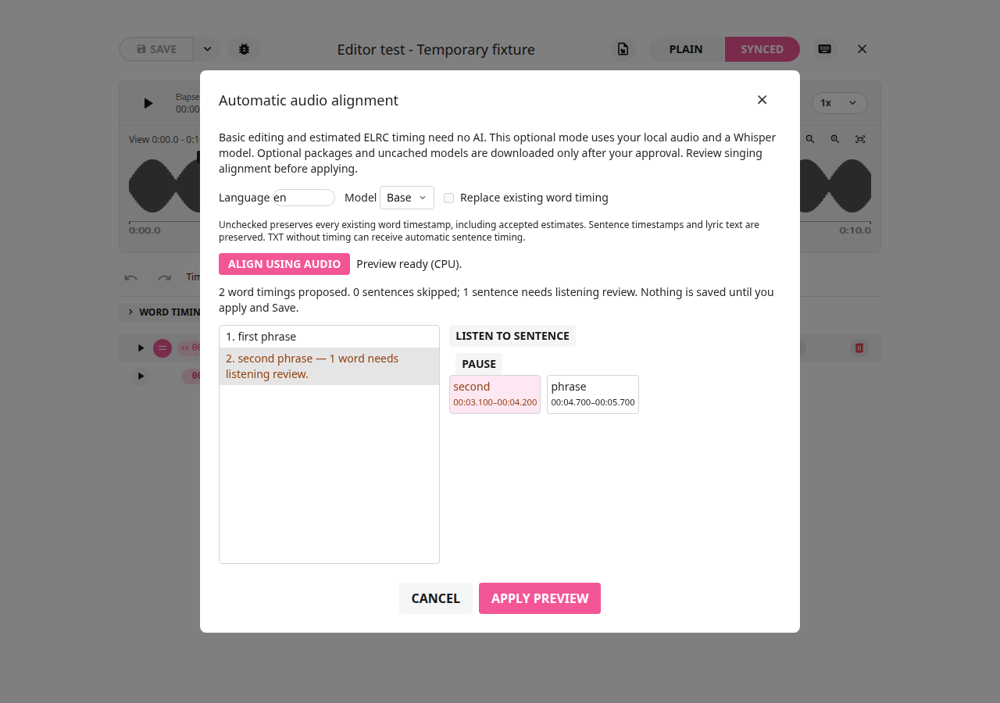
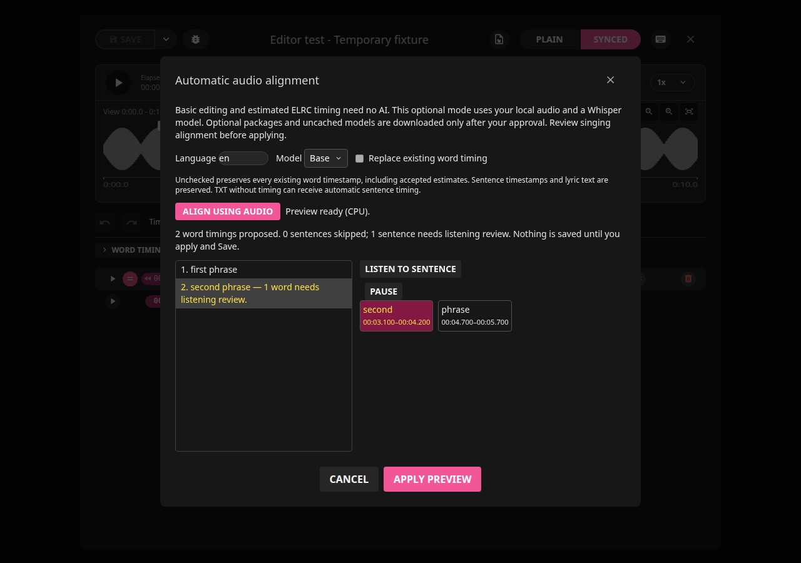

The worker uses stable-ts forced alignment against the provided lyrics, without
replacing words with recognized text. Timed LRC restricts analysis to each
sentence's existing audio interval. Untimed TXT receives provisional sentence
and word ranges; use complete lyrics for the chosen recording. Partial lyrics,
instrumental passages, repeated verses, backing vocals and incorrect text can
produce unreliable results. Invalid/zero-length/crossed timing is skipped rather
than silently written. Confidence is a review hint, not a calibrated guarantee
of singing accuracy. Listening and manual corrections remain necessary.

CPU is supported; CUDA is selected when available. VAAPI is a video encoder and
is not used for lyric alignment. No cloud transcription/upload is involved. Approved model
downloads use the model provider; once cached they can run locally. The original
audio, sidecars and database are not written by the alignment worker.

## Optional setup on Debian/Linux

Basic mode works without these packages. Automatic mode needs Python 3,
ffmpeg, PyTorch/torchaudio, OpenAI Whisper and stable-ts; WhisperX and Demucs are
not required. The model selector and alignment action remain disabled while busy;
**Align using audio** is grayed out until both the engine and selected model are ready.

On the first opening of Align words with an unavailable engine, the app asks once
whether to install it. **Not now** remembers that the question was shown in this
app profile. It never installs anything. Future openings retain the **Install
automatic alignment** button without automatically showing the question again.
Pressing that button reopens the details/approval panel. Closing the question also
counts as shown; it will not repeatedly interrupt editing. A failed attempt can
be retried with the same button.

**Yes, install** creates a private environment under
`~/.local/share/lrcget/alignment-environments/`. Existing compatible libraries may
be reused read-only; new packages install only inside this environment. A fresh
CPU setup pins torch/torchaudio 2.9.1, openai-whisper 20250625 and stable-ts 2.19.1.
Budget roughly 1–2 GB network transfer and at least 4 GiB free space, excluding
models. Actual sizes depend on existing packages and platform wheels. Progress
reports installation stages; it does not pretend to provide a precise download
percentage for pip. Cancel stops the worker and its children and removes its
owned staging directory. Verification must succeed before the new environment
becomes active. Cancellation/failure preserves any previous working environment.
Verified prior managed environments are retained for recovery; external Python
installations and other apps' files are never removed.

This private package installer currently requires **Linux with Python 3.10–3.12,
venv and ffmpeg already available**. It checks version, ffmpeg, space, package
imports and torch/torchaudio compatibility. Missing OS prerequisites need the
system package manager and administrator authentication; the application does
not silently install privileged system packages. On Debian/Mint, when needed:

```bash
sudo apt update
sudo apt install python3 python3-venv ffmpeg
```

After engine setup, a missing/damaged selected model offers **Download selected
model** with a separate **Yes, download** question. Declining leaves automatic
alignment disabled for that model; Basic mode still works. Tiny is approximately
76 MB, Base 146 MB and Small 484 MB. Allow the shown model size plus 105 MB free
space. Models use the official Whisper provider URL and published SHA256 values;
a staged download replaces its cache entry only after verification. Cancelled,
interrupted or corrupt downloads do not become usable models. Existing valid
models are verified and reused without a download. The alignment worker accepts
only verified local model paths and cannot silently download a missing model.

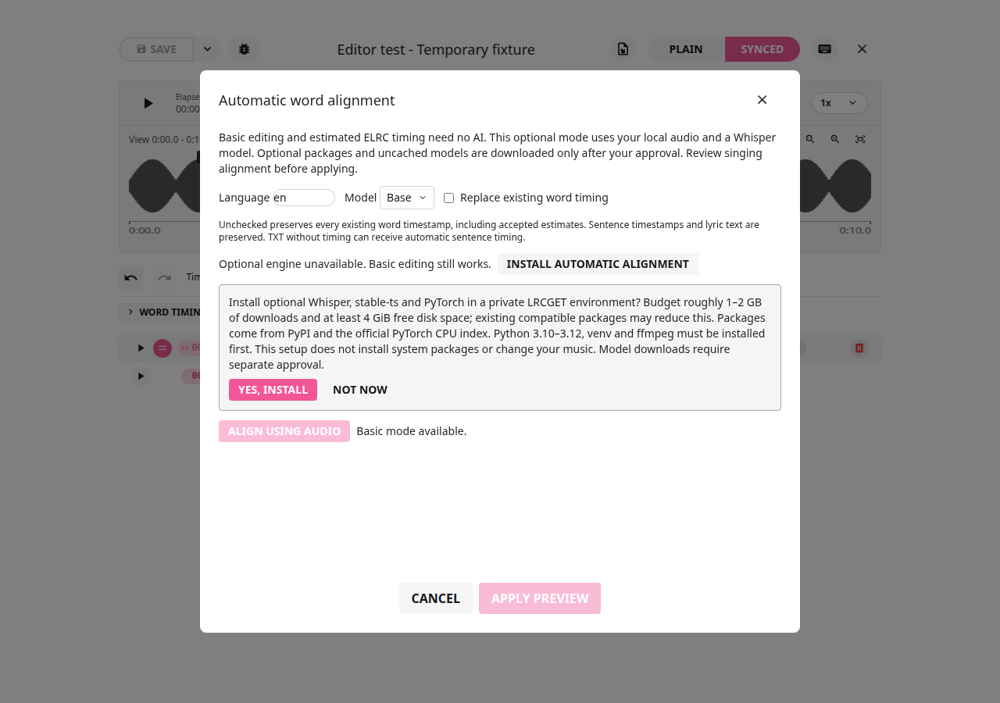
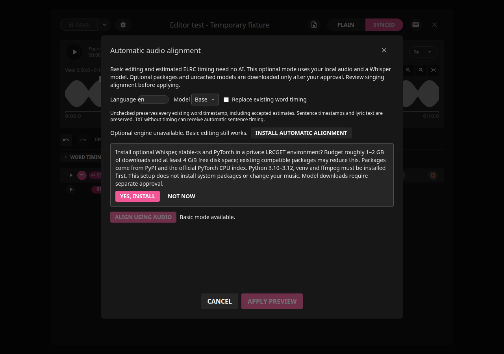
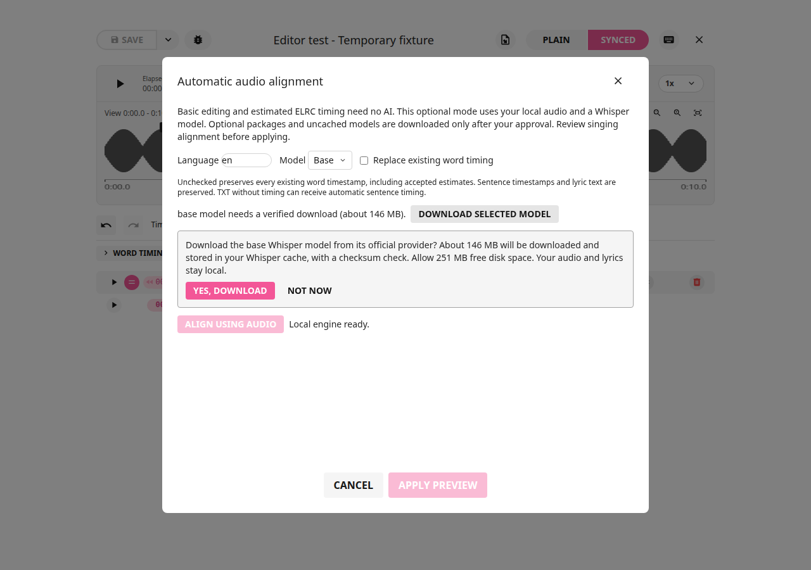
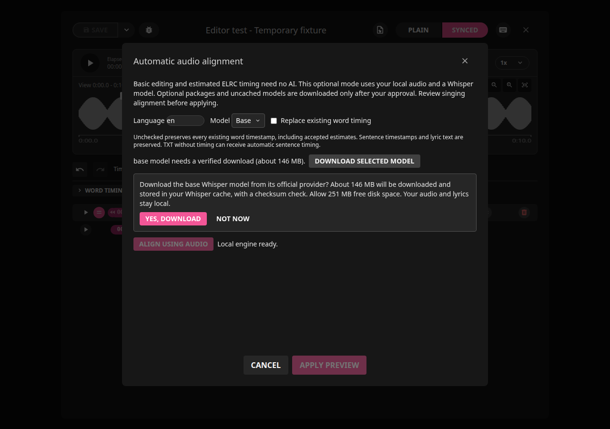
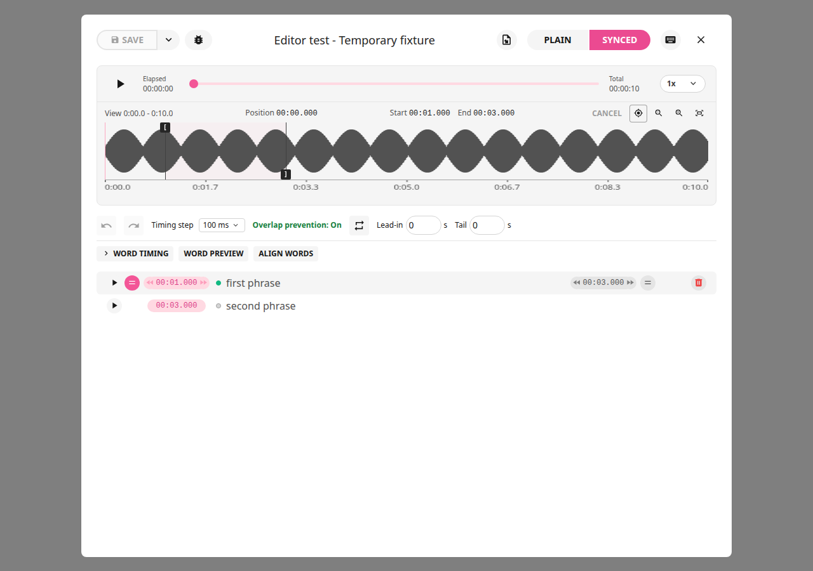
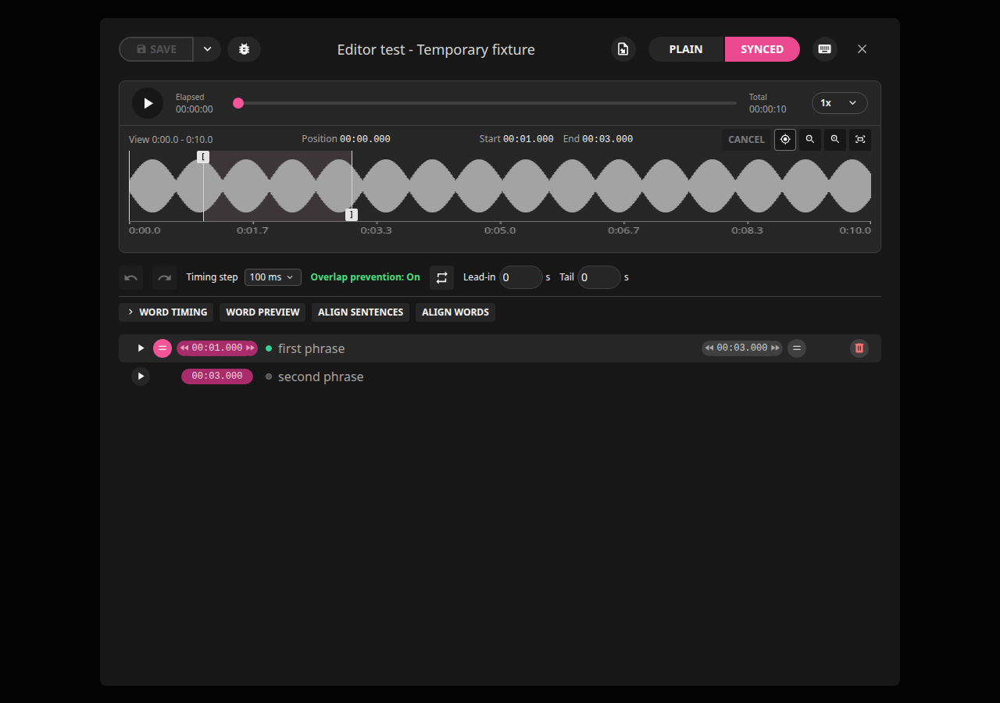

The older manual `~/.local/share/lrcget/alignment-venv` remains supported if no
managed environment has been activated. `LRCGET_ALIGN_PYTHON` overrides both;
managed setup asks you to remove that override or install into your custom
Python yourself. A failed availability check can mean broken/missing packages
or ffmpeg, not necessarily that Whisper is absent. No lyric editing/import/save
operation invokes this installer or downloads a model.

Package installation follows [stable-ts](https://github.com/jianfch/stable-ts)
and the official [PyTorch CPU installation guidance](https://pytorch.org/get-started/previous-versions/).
Whisper model URLs/checksums follow the
[OpenAI Whisper source](https://github.com/openai/whisper/blob/main/whisper/__init__.py).

## Installation failures and future platform builds

Network/proxy/TLS failures, unsupported Python/wheels, insufficient space, missing
venv/ffmpeg and failed imports leave Basic editing available. Correct the reported
prerequisite/network issue and retry. No security checks are disabled to bypass
these failures. A hard OS/process crash may leave inactive staging directories;
they are never selected as working environments. The prompt flag stores no audio,
lyrics or download approval; consent is specific to each explicit operation.

| Build                 | Optional dependency setup status and requirements                                                                                                                                                                                                                                                                                                                                                                                           |
| --------------------- | ------------------------------------------------------------------------------------------------------------------------------------------------------------------------------------------------------------------------------------------------------------------------------------------------------------------------------------------------------------------------------------------------------------------------------------------- |
| Debian/Mint           | Private engine installer, one-time prompt, separate verified model download, progress/cancel and Basic fallback implemented. Administrator installs missing Python/venv/ffmpeg through apt. Tested in a fresh private environment reusing compatible existing libraries; a completely clean 1–2 GB CPU dependency download was not exercised.                                                                                               |
| AppImage (held)       | Keep Basic usable without AI. Before resuming release builds, validate host Python/version/venv, ffmpeg availability, private writable paths and read-only bundle execution. Do not assume an AppImage supplies Python or CUDA.                                                                                                                                                                                                             |
| Windows 11 MSI (held) | Before implementing, provide a trusted Python/venv and ffmpeg provisioning path with license/source/checksum checks, per-user writable storage, Windows child-process cancellation and model verification. Account for permissions, locked files, PATH/architecture issues, TLS/network failures, Defender and security policies. Test install/upgrade/uninstall and actual Windows 11 launch; Linux/Wine does not establish these results. |

Future platform setup should use the same single-question/Install-button behavior
and separate model consent. No Windows/AppImage binaries are updated by this Debian
change. CUDA reuse is supported when compatible libraries/drivers exist, but the
managed fresh installation chooses CPU wheels and does not install GPU drivers.
Singing alignment still needs review regardless of platform.

Language codes and alignment API behavior follow the
[stable-ts documentation](https://github.com/jianfch/stable-ts).
See [editing](editing-guide.md), [exports](how-to.md) and
[troubleshooting](troubleshooting.md) for the existing no-AI workflow.

### Setup failure checks

Mock tests exercise missing ffmpeg/venv, insufficient space, declined consent,
failed/cancelled setup, separate model approval, cached reuse and corrupt downloads.
When inherited PyTorch packages fail their import/compatibility check, CPU repair
uses a private installation even if pip sees the same package versions elsewhere;
it does not replace shared packages. A failed progress-event subscription reports
that live progress is unavailable while still checking the engine/model normally.
It cannot falsely classify a working installation as missing. Run/Cancel remain
available; no additional installation is triggered by this notification failure.

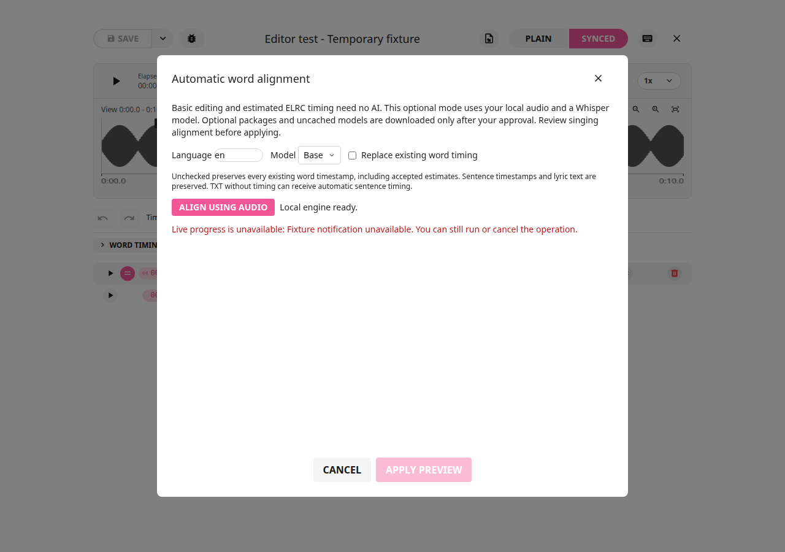
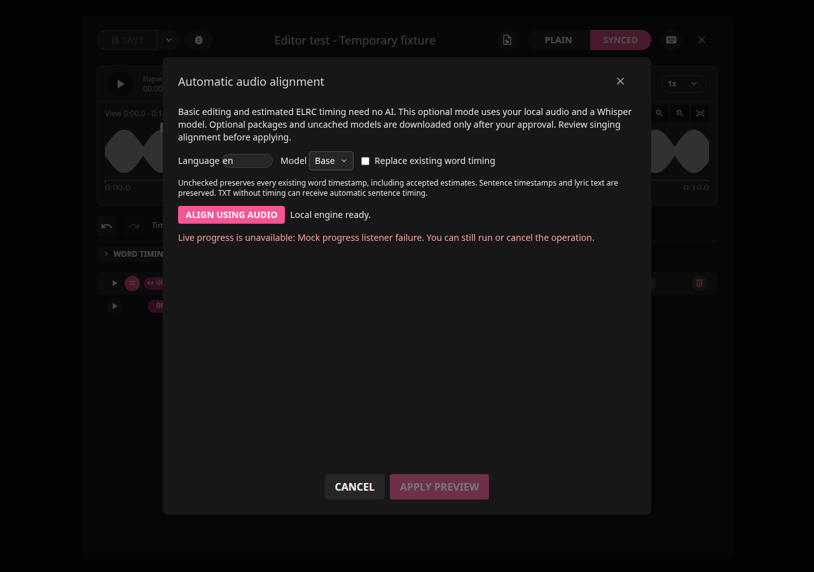

These Debian checks do not establish Windows or AppImage installation success.
Those builds require their own platform-specific failure and installer tests when
work on them resumes, including administrator/security restrictions and safe
recovery from interrupted setup.

### Full-song MP3 validation and skipped sentences

A real CPU/Base test on a temporary copy of Nevertel's Last Breath aligned 258
words across 39 of 49 lyric sentences using the existing LRC bounds. Ten sentences
were safely skipped because their proposed ranges were invalid; low-confidence
words on accepted sentences still need listening review. Complete untimed TXT
also returned proposals for 39 sentences, with ten rejected. This demonstrates
working alignment and validation, not guaranteed singing accuracy.

The preview separates **skipped** sentence counts from sentences needing listening
review. Skipped sentences retain their original document data; temporary word
segmentation cannot become saved untimed word entries merely by applying a preview.
When ELRC is selected, the normal save workflow offers explicit estimate approval
for missing word timing. Declining keeps the project unchanged. Estimates preserve
accepted/manual timestamps and are not labelled audio-derived results.

Sentence rows, Word preview and automatic preview now clear highlighting at an
explicit saved word end. Silence stays unhighlighted until the next word starts.
Without a word end, ordinary start-only timing continues to use the next start or
sentence end. Both themes, loop rewinds, pause, zoom and live timing edits use the
same rules. MP3/TXT/LRC/ELRC originals remained unchanged in the test; native exports
on the copy retained lyric text, ordinary sentence times and reimported word
highlight boundaries. Two independently edited word anchors were also preserved.

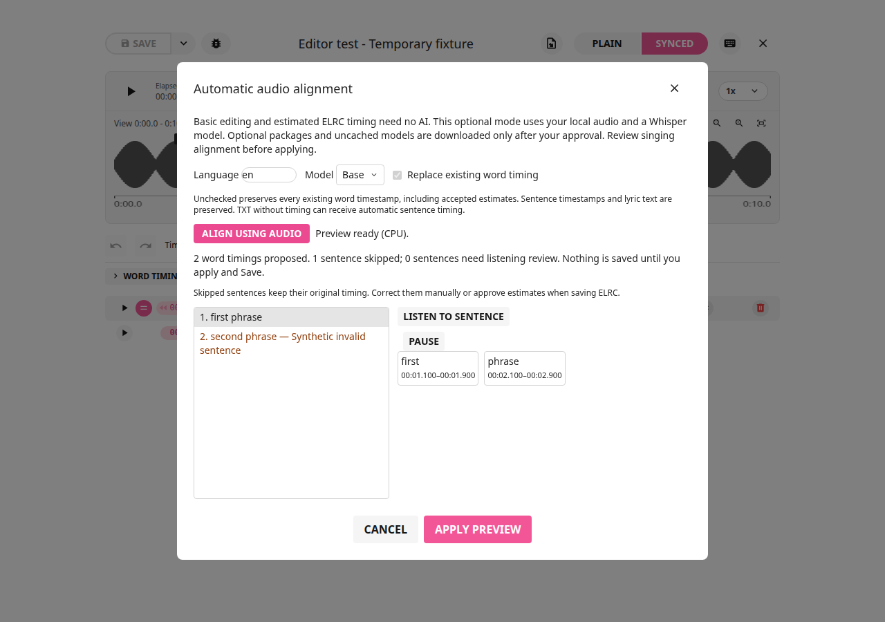
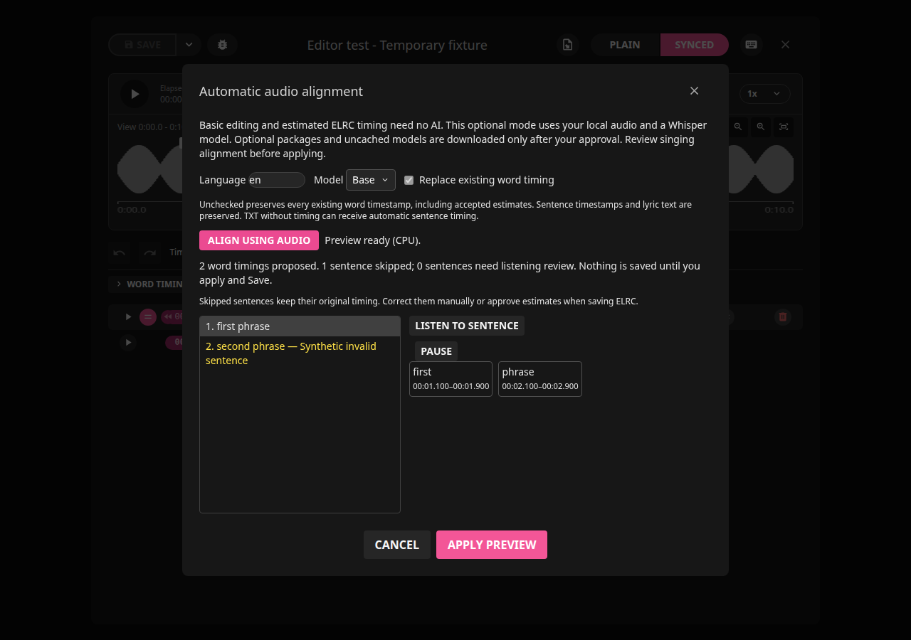
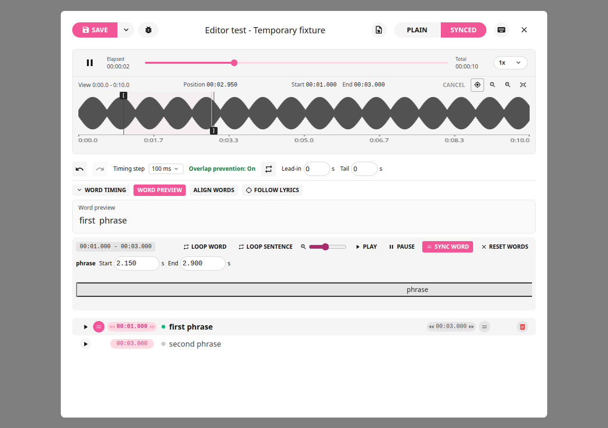
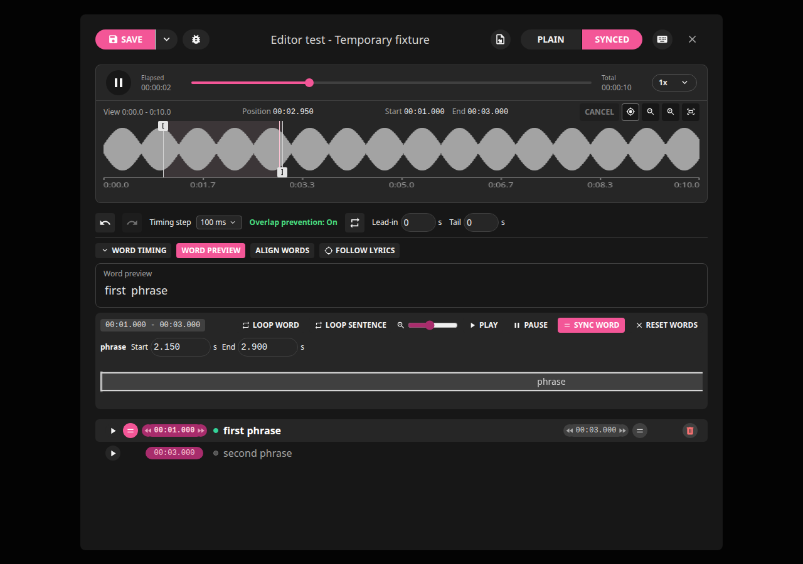

An engine result missing a sentence becomes a reviewable skip rather than failing
the whole alignment. Explicit invalid end times (including zero) are rejected;
they are never treated as absent and replaced with another sentence's start.
