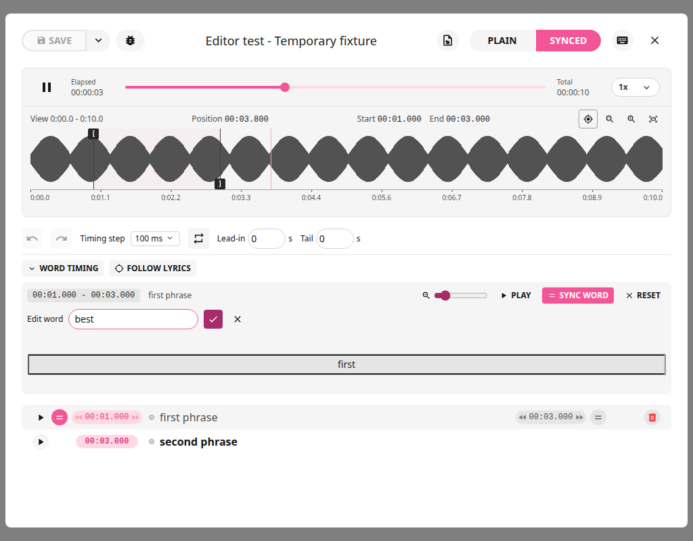

# Practical How-Tos

For Rick Lidgett's LRCGET **2.2.6+local.9**.
[Overview](app-overview.md) | [Full reference and shortcuts](editing-guide.md) | [Documentation home](README.md)

## Install or Upgrade

1. Use the current `.deb` and checksum in Downloads. The local.9 GitHub release
   remains unpublished until validation and the backup are complete.
   See [all package and source instructions](packages.md) for AppImage and Windows.
2. Close LRCGET. In the directory containing the download, run:

```bash
sha256sum -c LRCGET_2.2.6+local.9_amd64.deb.sha256
sudo apt install ./LRCGET_2.2.6+local.9_amd64.deb
```

3. Reopen LRCGET and let its startup scan finish.

The package upgrades the existing installed application, not a second copy.
This fork release supplies Linux amd64; upstream installers for other platforms
do not contain these enhancements.

## Add Music and Refresh the Library

1. Add the directory containing your recordings using the library controls.
2. Wait for scanning to finish, then open a recording's lyrics editor.
3. After adding/removing recordings, close editing dialogs and press **F5**,
   or choose **Refresh library (F5)** in the library menu.

Refresh does not export or publish. When a recording has Plain or missing
lyrics, a valid matching LRC created by another application is picked up on
startup or F5. Its words take precedence over matching TXT; TXT fills missing
lyrics when no valid LRC exists. Already synced/instrumental lyrics are protected
and require explicit import to replace the working document.

Before: the matching TXT has been imported as Plain.


After closing the app, creating a valid matching LRC and reopening: Synced.
Neither recording nor sidecar is rewritten by the scan.


## Create Timed Lyrics From a Text File

1. Prepare a UTF-8 TXT with one sung phrase per line.
2. If copying from Genius, remove page credits, `[Verse]`/`[Chorus]` headings,
   contributor counts and other words that are not sung. LRCGET does not strip
   them or scrape a Genius URL for you.
3. Open the corresponding recording in the lyrics editor. Click **Import lyrics
   file**, select the TXT and confirm replacement if prompted.
4. The untimed rows open in **Synced**. Start audio with the main playback button;
   an untimed row's own Play button is unavailable until its start is set.
5. Select the first row. Press **Space** when that phrase begins; press
   **Shift+Space** when it ends. Select the next row and repeat.
6. Replay uncertain phrases, refine boundaries with zoom/markers, then Save and export LRC.

Use shortcuts outside text input fields. To paste instead of importing, paste
your words into **Plain**, switch to an empty **Synced** editor and choose
**Import from plain lyrics**. No automatic speech alignment is performed.


Your source TXT remains unchanged. The working Plain and Synced versions are
separate; editing synced text does not silently edit Plain or the source TXT.


## Edit an Existing LRC or Timed Text File

1. Open the correct recording, not another mix/remaster with different timing.
2. Choose **Import lyrics file** and select its LRC or timestamped TXT.
3. Confirm replacement only when you want to replace the current document.
4. Select a synced line. Double-click its wording to correct it, or change its timestamps.
5. Listen to the start, last sung word and transition into the following line.
6. Save, then export LRC if you want the sidecar updated.

Import reads the source; export is the action that can overwrite an existing
destination. Leave TXT export unchecked to retain your original TXT. For
enhanced inline word tags or nonzero offset headers, convert to explicit
line timestamps before importing.

## Find Lyrics Online

1. Search LRCLIB from LRCGET's library/search workflow.
2. Compare title, artist and recording duration before selecting a result.
3. Load the result and listen against your own audio. Plain lyrics need manual timing.
4. If no suitable result exists, copy trusted sung words into a TXT and use the text-file workflow.

Downloaded timing is not proof of a matching recording. This editor does not
automatically create missing words with Whisper or separate vocals with Demucs.

## Place Precise Markers and Preview Before Confirming

The recording controls show **Elapsed** and **Total** in `hh:mm:ss`. The waveform
shows **Position** (current playhead, `mm:ss.mmm`) and **View** (visible zoomed
time range). **Start / End** belong to the selected lyric; they do not show the
recording duration. Moving the playhead does not change marker times.

1. In Synced, select a timed lyric. Its start/end markers appear on the waveform.
   Read **Start** and **End** above the waveform for their exact millisecond times;
   both remain visible when a marker is outside the zoomed view.
   A faint highlight between the lines shows that lyric's selected time range.
2. Pause and zoom around the boundary. Use the upper handle for start and lower
   handle for end; each has one vertical guide.
3. Drag a handle, or focus it and nudge with Left/Right using the chosen timing
   step. Shift makes a marker nudge ten times larger.
4. Replay or loop the preview. The preview clock and sentence highlighting follow
   the proposed start/end; saved row timestamps stay unchanged until confirmation.
   The time row is labeled **Preview** and updates while you drag or nudge.
   The highlight follows the preview and clips to the visible waveform.
   If a boundary crosses the previous lyric's end or next lyric's start, a
   warning shows the distance in seconds. Correct an accidental crossing with
   a nudge/drag or Cancel. **Prevent overlapping lyrics** is in Settings → Configuration → Common and on by default;
   turn it off explicitly to confirm an intentional overlap.
5. Use **Sync Sentence Start** and **Sync Sentence End** to confirm the corresponding
   moved marker as separate undoable edits. **Cancel** restores the last confirmed
   timings; confirming one boundary preserves the other pending preview.


Escape during dragging cancels that drag; otherwise it cancels the preview.
Changing phrases or closing discards unconfirmed previews. Confirm Start/End before Save/export.
For untimed text, first assign the line start; the provisional end says **Inferred
end** until you explicitly set or confirm it.

## Zoom and Follow Without Looping

1. Turn **Loop selected phrase** off for continuous playback.
2. Enable the crosshair **Follow waveform playback** button above the waveform.
3. Use Zoom in or double-click a waveform point repeatedly. Zoom preserves the
   audio position; Play continues from the current point. A single waveform click
   starts playback from the clicked point, including when paused.
4. Continue playing: the viewport advances when needed, retaining magnification.
5. For fixed-region editing, pause, turn Follow off or pan manually.


Zoom does not disable Follow. Manual panning temporarily holds the view;
pause/play or the crosshair resumes following. An explicitly disabled Follow
stays disabled until you enable it. Use the wheel, trackpad or bottom pan slider
to reach off-screen markers. Zoom and scrolling never change marker timestamps.

**Follow Lyrics** is a separate control: it selects the active lyric/word boxes.
Use waveform Follow for viewport movement, Follow Lyrics for editing selection.

## Loop Between the Markers

1. Select a timed lyric and enable **Loop selected phrase**.
2. Set **Lead-in** and **Tail** to zero for exact marker-to-marker repetition.
3. Move/release marker previews to audition the revised range.
4. Confirm the corresponding Start/End when satisfied; Cancel restores saved bounds.
5. Turn Loop off to keep playing forward.

Lead-in/Tail add context to playback, not the saved lyric timestamps. Changing
selected lines moves the loop to the new lyric's markers while Loop stays on.
Sentence Play and word playback also retain Loop. Turn the Loop button off for
continuous playback. Untimed/reversed selections suspend repetition, keeping
Loop on and showing a short status message; select valid markers to resume.
Switching to Plain temporarily suspends repetition; returning to Synced resumes
it. Changing recordings, closing the editor or a playback failure resets Loop.


## Edit Individual Words

1. Select a timed row and expand **Word timing**.
2. Use its separate zoom/scrolling to inspect individual word boundaries.
3. Select a word/separator, use **Sync word** at playback or drag its divider,
   then listen again. The lane's zoom does not change waveform zoom.
4. To correct spelling, select its box and use **Edit word**, F2 or right-click.
5. Press Enter/check to apply or Escape/cancel to discard the wording draft.



Spelling changes retain whitespace/timing. Use explicit split/merge for structure.
Double-click splits a word. Reset deliberately rebuilds that line's word timing;
do not use it merely to close the tools. Undo/Redo restores synced edits within
the session. Moving the first word start may also move the sentence start.

## Save and Export for Playback

1. Confirm any pending marker previews with Sync Sentence Start/End.
2. Click **Save** to retain the local lyric document.
3. Open the arrow next to Save. Select **Synced lyrics (.lrc)** to write a timed
   sidecar. Select Plain TXT only if you also want that destination rewritten.
4. Optionally select **Embed into track** for supported MP3/FLAC files.
5. Click **Save and export** and check the result for each selected target.


If embedding is grayed out, enable optional embedding in Settings and check
the file type. The supported output is MP3 ID3v2.4 USLT/SYLT or FLAC metadata;
audio is not re-encoded. Some players do not display embedded lyrics even when
the tags are valid. Keep/export the LRC sidecar as needed.

Save alone does not write an LRC or embed lyrics. Export does not publish online.
TXT and LRC coexist; one is not deleted by exporting the other. Successful saves
leave no new `.bak` files. Old app-owned backups for that saved destination are
removed when permitted. Failed staging preserves the original. No version history
is retained automatically; keep your own backups when needed.

## Publish Lyrics for Other Users

1. Confirm wording/timing against the exact recording.
2. Open the Save arrow and choose **Save and Publish**.
3. Review the publication details and confirmation for the configured LRCLIB instance.
4. Publish only lyrics you intend to share.

This is different from local saving/exporting. Other LRCLIB clients can discover
published lyrics, subject to the service's availability/search behavior. The
publication uploads lyric data, not your audio file or this app's installer.

## Check Modified Dates

1. Change a lyric word or timestamp, then explicitly Save.
2. Return to the library: **Modified** appears after Lyrics with local date/time.
3. Restart or refresh; the saved date remains.


Opening a song or saving unchanged content does not update the date. Unknown
historical dates show `--`. Creating a new timeline from your plain text and
saving it counts as a modification, just like editing an existing timed lyric.
Embedding changes the file fingerprint but now keeps
the track identity/date. Matching orphaned dates from older scans are repaired
without rewriting the current lyrics; ambiguous matches are not guessed.

## Troubleshooting

| Symptom                               | What to Check                                                                                                                                       |
| ------------------------------------- | --------------------------------------------------------------------------------------------------------------------------------------------------- |
| Playhead leaves the zoomed view       | Enable waveform Follow; manual panning holds inspection; double-click zoom now preserves Follow                                                     |
| Markers do not advance with sentences | Enable Follow Lyrics; manual selection, edits and loops pin the target                                                                              |
| Audio stops/repeats at a marker       | Turn Loop off for forward playback; sentence Play retains an enabled Loop                                                                           |
| Row playback unavailable for TXT      | Provisional markers do not assign timing; confirm its start first                                                                                   |
| End says Inferred end                 | Set end at playback or confirm the intended pair with Sync Sentence Start/End                                                                       |
| Lyrics do not show in another player  | Export LRC/embed, rather than only Save; verify that player's format support                                                                        |
| An external LRC edit is absent        | Reopen or press F5 to upgrade missing/Plain lyrics from a valid matching LRC. Already synced lyrics require explicit import to protect saved edits. |
| Save is disabled or date unchanged    | No unsaved document changes; import/timing/text edits must be saved                                                                                 |
| Embedded option is disabled           | Saved embedding setting and supported file type                                                                                                     |
| Export partly failed                  | Review each target; successful targets may already be written; fix permissions/path and retry                                                       |
| Waveform is unavailable               | Use Retry; text editing/basic playback remain separate from waveform availability                                                                   |
| Hover help seems delayed              | Off by default. Enable Show hover help in Configuration and Save, or press F1 over a control                                                        |

Screenshots use temporary demonstration fixtures. Detailed keyboard bindings,
format limits and safety behavior are in the [editing reference](editing-guide.md).

Linux compatibility: the shared hover-help behavior is independent of desktop
environment. This amd64 installer requires glibc 2.39 or newer, GTK 3 and
WebKitGTK 4.1 (such as Ubuntu 24.04 / Mint 22 or compatible newer systems).
Older Debian-based releases and ARM need a build for their platform; a `.deb`
extension alone does not guarantee binary compatibility.

## Turn Hover Help On or Off

Open **Configuration**, change **Show hover help**, then **Save**. It defaults off
and remembers your choice between launches. With it on, help appears after a
one-second hover and closes after two seconds. With it off, use F1 over a control
or while that control has keyboard focus. Closing Configuration without Save
discards the change. Menus and marker warnings are unaffected.


## Preserve Sentence Ends When Exporting

1. Confirm Start and End with the sentence Sync controls, then Save.
2. Export LRC. Gaps of at least 250 ms become blank timestamped cues; final ends
   are included. Tiny gaps are omitted to avoid flashing lyrics between sentences.
3. Reopen the saved song to retain exact end-marker times. If importing only the
   LRC, its exported blank cues appear as real empty timed rows; omitted short
   gaps cannot restore their exact end times from that file alone.

## Turn Overlap Prevention On or Off

1. Open Settings (**Configuration**) and find **Common**.
2. Check or uncheck **Prevent overlapping lyrics**, then click **Save**.
3. In Synced, read **Overlap prevention: On/Off** beside Timing step. This text
   is informational; clicking it cannot change the setting or affect Loop.

The choice survives restarting. Cancel and failed saves preserve the prior choice.
Turning protection on does not automatically change existing lyric overlaps.


## Confirm Marker Previews and Cancel

After moving a waveform marker, its original sentence Sync icon turns amber.
Only the color changes; there is no extra text or button resizing.
The start button beside Play confirms only the pending start; the end button
confirms only the pending end. Without a pending edit, each ordinary button still
uses the current playback position.

**Cancel** is always visible beside the waveform marker times. Release the drag,
then Cancel to discard every unconfirmed movement, even after repeated edits or
zooming. It restores the last confirmed pair; it keeps any boundary already
confirmed. **Undo** reverses confirmed edits, and **Redo** reapplies an undone edit.
F1 over either arrow explains its action, including when disabled.

Word Timing shows the time range and editable word boxes without repeating the
sentence in its header.


## Export Word Timing as Enhanced LRC

Enhanced LRC export is optional. Under **Save → Export to track’s directory**,
select **Word-timed lyrics (.elrc)**. It starts unchecked; selecting or clearing it
is remembered across editor openings and app restarts. Configuration has no
separate ELRC default switch. Existing saved selections are preserved.

Confirm your edits, including word timing, before exporting. ELRC uses the saved
word starts and ends, with millisecond precision; it preserves known word silence
and the existing sentence gap cues. Mixed documents keep line-only sentences as
normal timed lines. It does not analyze the recording or create accurate karaoke
timing automatically. No saved word timing means ELRC is skipped; invalid saved
word timing reports an error. Both cases leave an older ELRC untouched, and the
other selected formats still run. Check partial-export messages.

Example of a saved word-timed line:

```text
[00:01.000]<00:01.000>Hello <00:01.500>world<00:02.000>
[00:02.000]
```

The final inline tag marks the word end; the empty timestamped line clears the
sentence. Existing rules avoid unnecessary sentence clear cues for gaps under
250 ms. TXT remains plain text, and standard LRC remains line-timed.

Keep the local saved lyric document to reopen and edit word timing. The editor
can also import TXT, LRC and ELRC with the file picker; explicit word ends and
gaps are retained. Automatic library scanning for .elrc sidecars is not added. Karaoke display depends on the
player. Jellyfin 10.11's server parser supports word cues, but this update does not add
word highlighting to Jellyfin's web player. Keep standard LRC for line playback.
Sources: [Jellyfin LRC parser](https://github.com/jellyfin/jellyfin/blob/v10.11.0/MediaBrowser.Providers/Lyric/LrcLyricParser.cs),
[Jellyfin web lyric player](https://github.com/jellyfin/jellyfin-web/blob/v10.11.0/src/controllers/lyrics.js).


## Review Words Without Resizing Timing Boxes

1. In **Synced**, select a sentence and enable **Word preview** beside Word timing.
2. Press Play. The readable text highlights one word at a time using the current
   word boundaries. Boxes can stay collapsed; resizing is unnecessary.
3. **Follow Lyrics** is enabled when you turn on the preview. It follows the playing
   sentence. Manual selection/editing holds the target; re-enable Follow Lyrics
   when you want to continue through the song.
4. Turn on **Loop selected phrase** to repeat that phrase. The preview follows
   every rewind, and Loop remains enabled until you turn it off. Lead-in, tail,
   waveform zoom and word-timeline zoom retain their existing behavior.
5. Turn off Word preview to hide it. No timestamps change and nothing is saved or
   exported by this toggle. Preview state lasts for this editor session.

Explicit word ends clear the highlight during gaps. If no word timing is saved,
the preview labels its evenly spaced estimate; it cannot infer actual singing.
To create accurate word timing, expand Word timing and use Sync word against
playback, then save. The readable preview remains independent of box size/zoom.


## Embed Standard and Enhanced Lyrics in MP3

Configuration now calls the section **Embedded lyrics**, with **Enable embedded
lyrics** as the saved opt-in. It remains an optional, saved setting.

| Frame                            | This build writes                                            | Meaning                                                 |
| -------------------------------- | ------------------------------------------------------------ | ------------------------------------------------------- |
| USLT                             | Plain lyrics in the ordinary frame                           | Unsynchronized UTF-8 text                               |
| USLT, description `Enhanced LRC` | Optional complete ELRC text                                  | Text storage; this frame itself is unsynchronized       |
| SYLT                             | Line timing normally; word timing with Enhanced LRC selected | Binary synchronized strings with millisecond timestamps |
| TXXX, description `LYRICS_ELRC`  | Optional complete ELRC text                                  | Custom text field; name is this app's convention        |

For Enhanced MP3 embedding, select **Word-timed lyrics (.elrc)** and **Embed into
track** together, then Save and export. Normal plain USLT remains available while
ELRC has its own description. Missing saved word timing skips the ELRC sidecar
and uses normal line embedding; invalid requested word timing stops MP3 embedding
and leaves the old file intact. Ordinary embedding replaces old lyric variants
and removes the app's stale custom ELRC field, preserving unrelated metadata.

TXT, standard LRC and ELRC sidecars remain independent and can all be selected.
The app creates staged copies, verifies written lyric frames and atomically
replaces the selected audio file. It does not re-encode audio. Player support for
SYLT, ELRC text and custom fields varies; storing valid frames does not add karaoke
to every player. FLAC continues to use Vorbis lyric comments rather than ID3.
See [ID3v2.4 frame definitions](https://id3.org/id3v2.4.0-frames) and
[encoding/language rules](https://id3.org/id3v2.4.0-structure).


## Loop One Word for Precise Timing

1. Open **Synced → Word timing** and click the word you want to adjust.
2. Enable **Loop word**. It repeats that word until you turn the mode off.
3. Use **Lead-in** and **Tail** above the word lane for extra listening context;
   these change playback only, never saved timestamps. Both start at zero.
4. Set **Timing step** to **10 ms** or **25 ms**. Adjust the selected word’s
   **Start** and **End** fields in seconds (three decimal places), using the input
   arrows or typing the exact time. Boundaries are clamped to the sentence and
   neighboring words. These fields edit the word without moving sentence markers.
   The loop follows accepted edits. You can also drag starts.
5. Slow playback if needed. **Sync word** stays on the selected word while its
   loop is enabled; it does not automatically advance to another word/sentence.
6. Click another word or use the boundary navigation keys to move the loop.
   Zoom/scroll changes only the view. Word labels remain visible while scrolling.
7. Turn **Loop word** off when finished. Phrase Loop switches back to repeating
   a sentence; the two modes never run together.

Explicit word ends preserve silence gaps; missing ends use the next word start
or sentence end. Estimated timing is labeled and is not saved merely by looping.
Editing estimated word boundaries saves word timing in the lyric document.
**Undo** restores timing edits. **Reset** returns word timings to estimates.

Collapsing Word timing suspends word repeats and preserves the target. Reopen to
resume, or use **Stop word loop** without reopening. Inactive tabs and untimed
sentences also suspend repeats; switching tracks or closing the editor ends the
loop. Playback auditions use the existing player clock (40 ms updates), so loop
playback is not sample-accurate; saved timestamps retain millisecond precision.

Save/export keeps the existing TXT, LRC, ELRC and MP3 embedded format choices.
Loop selection, context and zoom are listening aids, not exported lyric events.


## Sync Every Word in a Sentence in One Continuous Pass

This is manual timing: one press per word, not automatic singing recognition.
The existing Sync word action advances through boundaries; no separate
one-click sentence alignment mode has been added.

1. Set the sentence start/end first, then expand **Word timing**.
2. Turn **Loop word** and phrase **Loop** off so audio continues through the sentence.
3. Select the first word boundary and play from just before the sentence.
4. Use **Sync word** as each word starts. It stamps playback time and advances
   to the next boundary. After the final boundary it may select the next sentence.
   Use the keyboard menu to check the current word timing shortcut; do not
   invoke shortcuts while typing in a time or spelling field.
5. Pause and inspect the result. Use Undo for a mistaken stamp. Do not use Reset
   to undo a single mistake: Reset replaces the sentence's word timings with estimates.
6. Select uncertain words and turn **Loop word** on for refinement. In that mode,
   Sync word stays on the current word. Use **Start** and **End** for its precise
   bounds, and Lead-in/Tail for listening context without changing saved times.
7. Save the document and select **ELRC** under the Save file types if you want a
   word-timed sidecar. Standard LRC remains sentence timed; selecting ELRC does
   not replace the independent TXT/LRC choices. Publishing sends the structured lyric document, including confirmed word
   timing, to a compatible LRCLIB server; it does not upload an ELRC sidecar file.


Saved word timing is more than the displayed estimates. Looping or previewing
estimates alone does not save them as measured word timings. End fields permit
silence between words; listen through transitions before export.

## Download and reopen word-timed lyrics

Search normally to see **Word timed**, **Synced** and **Plain** records. The app
checks actual timestamps rather than trusting a server flag. **Show only word-timed
lyrics** is optional and starts unchecked. If no word results appear, uncheck it
to use ordinary LRC or plain lyrics. Applying/download preserves the server's
structured document, including confirmed word starts/ends. No word timing is
invented when the server only supplies sentence timing or untimed text.

Use the editor's lyric-file import picker to open TXT, LRC or ELRC. Enhanced tags
inside .lrc files are recognized. Replacement follows the existing confirmation
and Undo workflow. Saved explicit word gaps remain editable after reopening; a
standard LRC alone cannot preserve word timing. Nonzero offsets and ambiguous or
invalid enhanced ranges need correction before import.

Under **Save file types**, select only TXT, LRC, ELRC, or any combination. These
choices do not require one another. ELRC starts unchecked and remembers changes.
Without saved word timing, ELRC is skipped rather than estimated. Local export
and server publishing are separate: compatible LRCLIB accepts structured YAML
with word timing, not a dedicated uploaded ELRC sidecar. Older/custom servers
may offer only ordinary LRC or text. See [LRCLIB API documentation](https://lrclib.net/docs).


