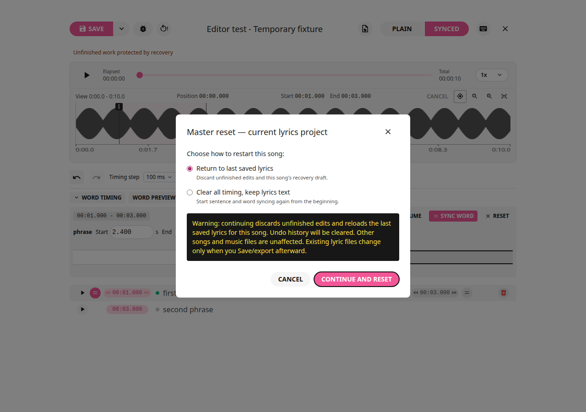
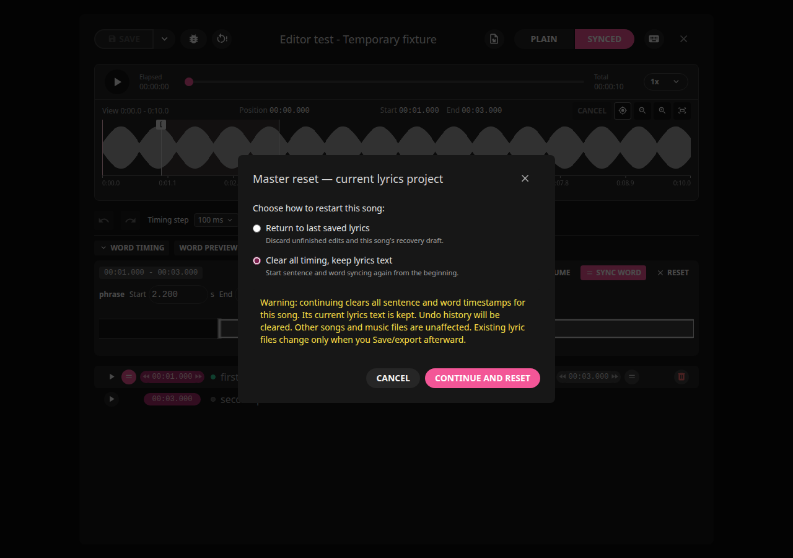
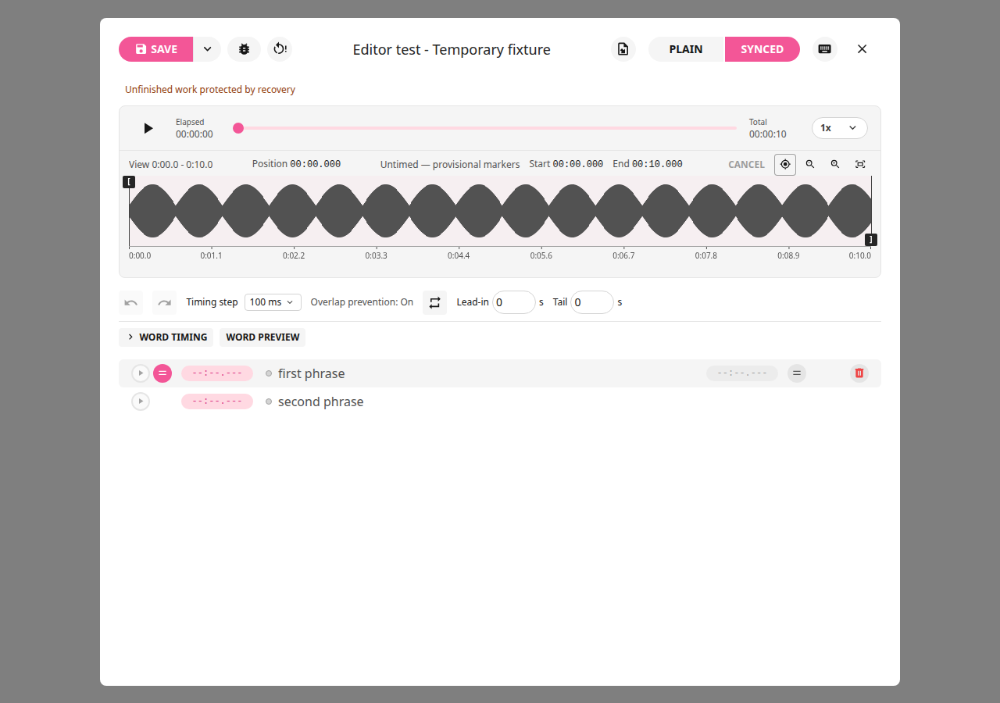
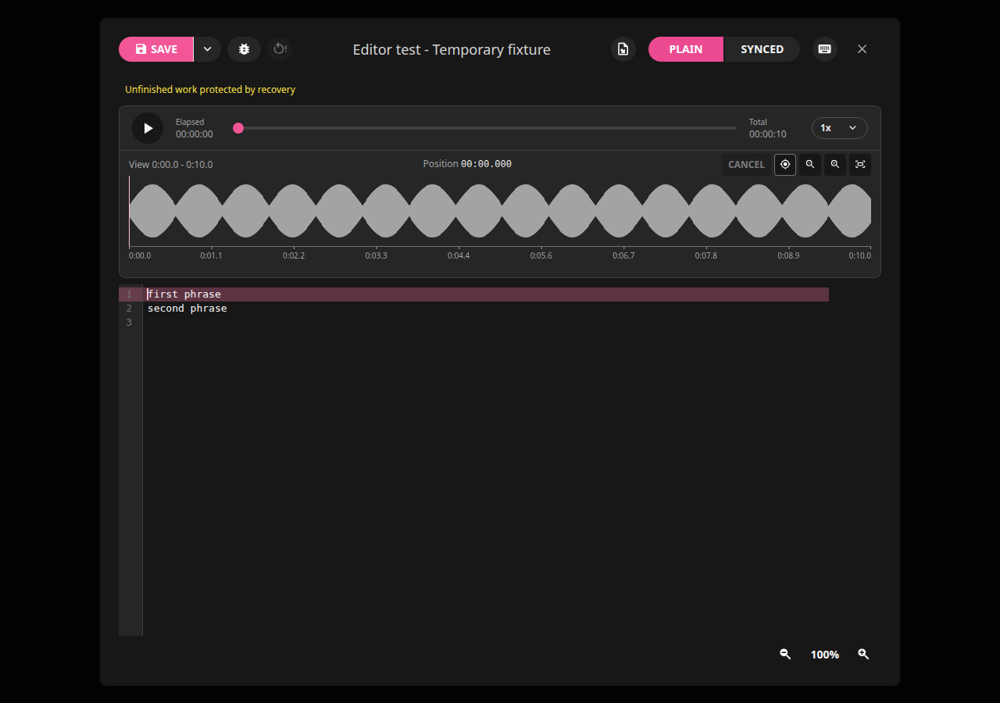

# Archived Master reset feature

Master reset was removed from the current 2.2.7 maintenance build at Rick’s
request. The historical behavior below is retained for older builds only.
Use **Reset words** for the selected sentence’s word timings, Undo for edits,
and Import for replacement TXT/LRC/ELRC data. See the
[current editing guide](editing-guide.md#word-editing-follow-and-confirmation).

# Master reset — restart the current lyrics project

The reset icon sits beside the **View YAML debug** bug icon, next to Save in the
editor's top bar. It remains visible in both tabs. It is gray/disabled in Plain
mode and works only in Synced editing. Saving/exporting/importing also disables
reset. Clicking the icon opens choices and a warning; it does not reset anything.

## Return to last saved lyrics

Select **Return to last saved lyrics**, read the warning and choose **Continue
and reset**. This discards the current song's unfinished edits, pending sentence
text, waveform previews, Undo/Redo history and recovery draft, then reloads the
last internally saved lyrics. If nothing was saved during this session, it
returns to the lyrics originally loaded into the editor. A new empty project
returns to its empty starting state. Other songs' drafts and files stay intact.

## Clear all timing, keep lyrics text

Select **Clear all timing, keep lyrics text**, read the warning and choose
**Continue and reset**. This keeps the current Plain and sentence wording,
including unfinished sentence typing, but clears every sentence start/end and
word timestamp. Selection returns to the beginning and old word/marker previews
and Undo/Redo history are cleared. Loop turns off. Existing saved lyrics and
exported files remain unchanged until explicit Save/export.

The fresh untimed working copy is protected by recovery. Set sentence starts
and ends, then sync individual words if desired. TXT, LRC and ELRC imports all
use the same editor document: TXT can begin untimed, LRC resets its sentence
times, and ELRC resets sentence/word times. Standard LRC/ELRC need new timing
before timed export is useful; TXT and the internal Save can retain untimed text.

## Safety and cancellation

**Cancel** or the dialog's close button keeps all current edits and drafts.
Confirmation affects only this song's lyrics project. It never deletes music,
other songs, exports or unrelated temporary files. Editor shortcuts cannot Save,
Undo or Sync behind the warning. Changed targets/documents and busy saves/imports
refuse a stale reset; cancel and reopen it. A failed recovery-draft deletion keeps
current work intact and reports the error.

After manually saving untimed/reset lyrics, startup/F5 scans protect that explicit
save from an older matching LRC. Matching LRC still upgrades missing or automatically
imported/downloaded Plain records. Use Import to replace manually saved work with
an external TXT/LRC/ELRC. The library status and Modified date change only through
normal Save; opening the reset warning, canceling or resetting the working copy
makes no library/database writes.

