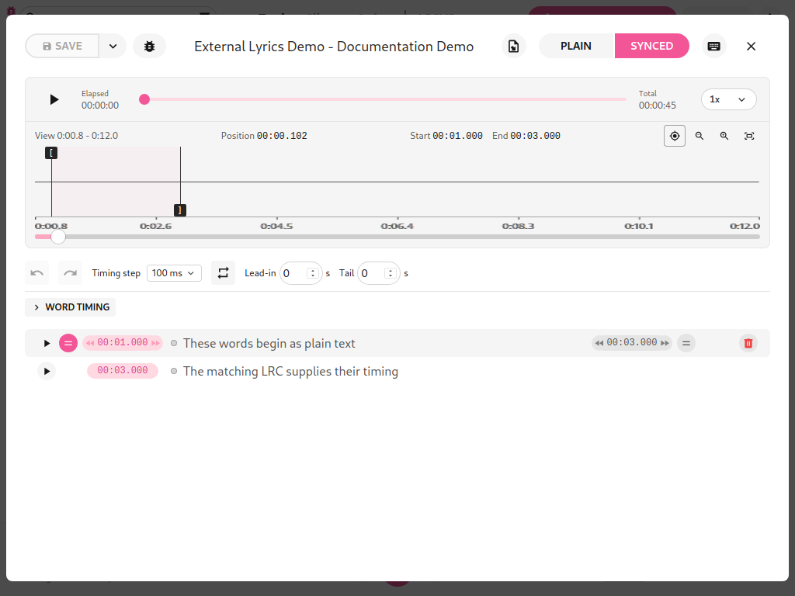
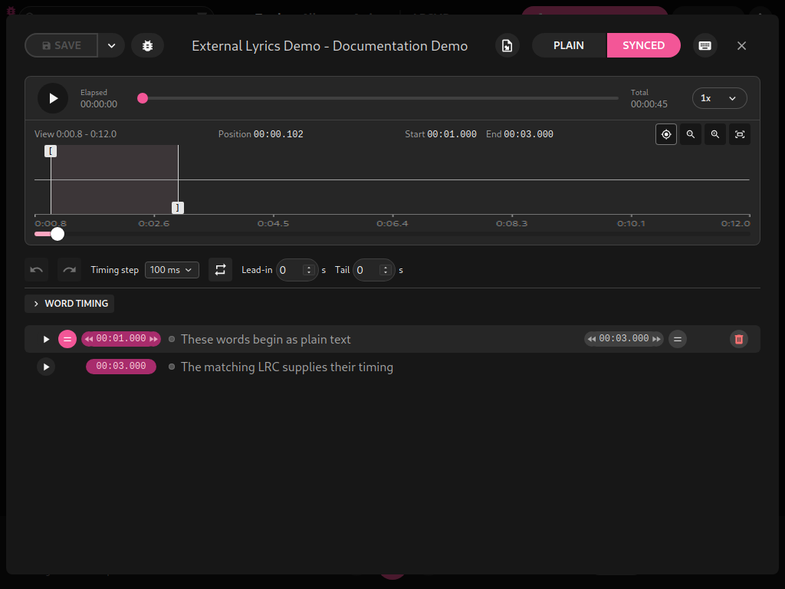
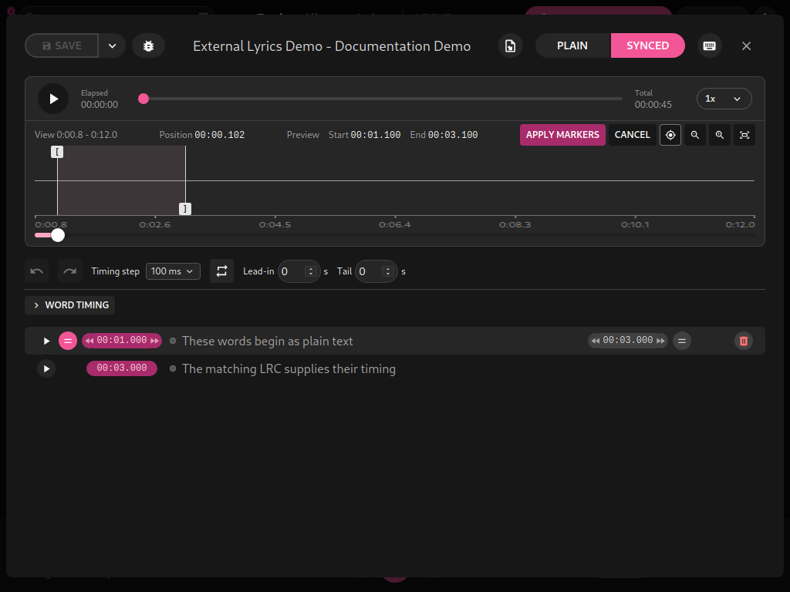

# LRCGET 2.2.1+local.1

This independent fork release adds persistent **Start** and **End** marker times
above the waveform. Selecting a timed lyric shows both times immediately, with
milliseconds, even when a marker is outside the zoomed view. Dragging or nudging
updates the same readout. **Preview** identifies unconfirmed edits; Apply Markers
commits them and Cancel restores the saved pair. Untimed/invalid selections hide
the row, and inferred ends retain their hover/accessibility explanation.

The labeled row replaces the old unlabeled preview pair, with no extra buttons.
Elapsed/Total label the recording clocks; Position labels the precise playhead,
and View labels the zoomed waveform range. A faint highlight joins the selected
Start/End boundaries, follows their previews, clips to the viewport and never
blocks clicks or marker drags.
The version advances from 2.2.0+local.22 to 2.2.1+local.1; the local suffix
identifies this fork. All previous waveform click/play, zoom continuity, smooth
playhead, external-LRC detection, editor and export improvements remain included.
Original authors and license remain credited.

## How to use it

1. Open a recording's lyrics editor and switch to Synced.
2. Select a timed lyric. Read Start and End above the waveform.
3. Zoom and drag/nudge either marker. Preview shows the proposed pair while the
   lyric row retains saved times.
4. Apply Markers to confirm, or Cancel to restore the saved pair.






## Validation

All 382 frontend tests passed, along with scoped ESLint, Prettier and Cargo check.
Native desktop checks verified a clear layout without overlaps/overflow at
1024px in both themes and correct preview/cancel behavior. Regression coverage
includes live dragging, off-screen markers, untimed selections and inferred ends.
No Python implementation changed; Ruff reports 11 existing findings in the
unchanged fake-music helper. Existing compiler and bundle warnings remain.

## Install

Close LRCGET, download the Debian installer and checksum, then run:

```bash
sha256sum -c LRCGET_2.2.1+local.1_amd64.deb.sha256
sudo apt install ./LRCGET_2.2.1+local.1_amd64.deb
```

See the [updated how-tos](../how-to.md), [feature overview](../app-overview.md)
and [editing reference](../editing-guide.md).
