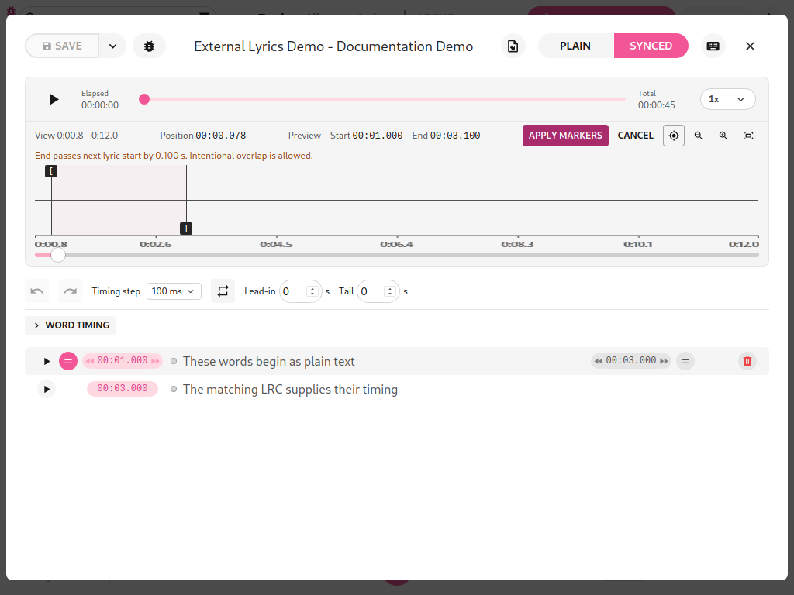
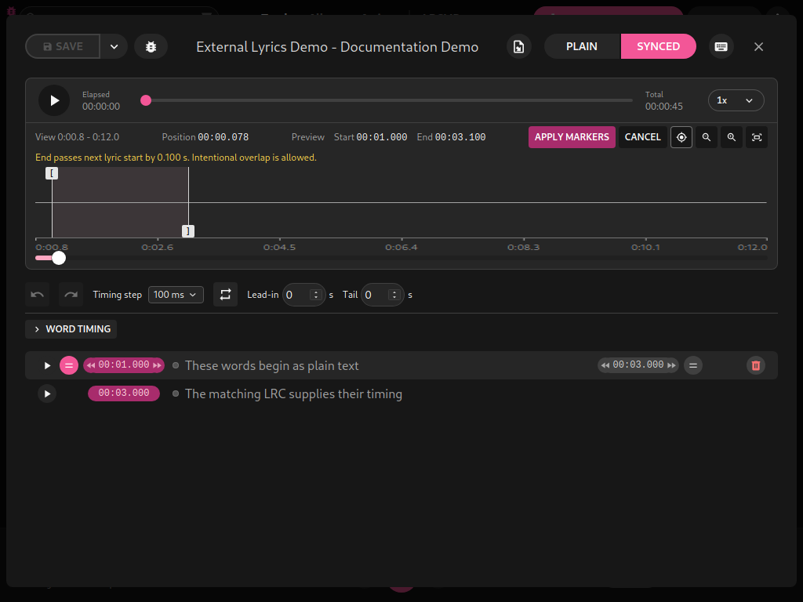
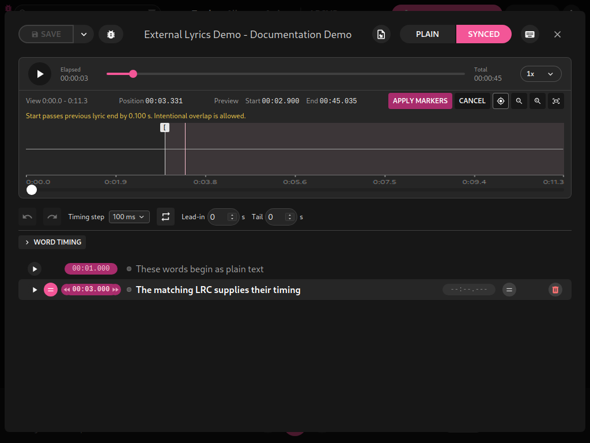

# LRCGET 2.2.2+local.1

Marker editing now warns before a boundary crosses the previous lyric's end or
next lyric's start. Warnings update from the live drag/nudge preview and remain
visible while zoomed/panned. Exact adjoining boundaries do not warn; untimed
neighbors are skipped. A previous lyric with an inferred end uses the saved
current start. Distances describe crossed boundaries rather than claiming the
full duration of overlapping phrases.

Intentional overlaps remain allowed. Apply changes only the selected lyric;
Cancel restores the saved pair and its warning state. The conditional warning
row adds no buttons or confirmation dialogs.

The final lyric's Loop now uses the known recording end when its end is inferred,
matching the waveform's inferred-end behavior. An unknown duration keeps that
loop unavailable until the recording loads.

All earlier precise Start/End times, range highlighting, Elapsed/Total/Position/
View labels, click-to-play, zoom continuity, editor tools and safe export features
remain included. The package upgrades the same `lrcget` application and retains
its identifier/data location. This is an independent fork; upstream credits and
license remain intact.

## How to use it

1. Select a timed lyric in Synced and zoom to a boundary.
2. Drag or nudge Start/End. Read the warning if it crosses a neighboring boundary.
3. Correct accidental crossings or keep an intentional overlap with Apply Markers.
4. Cancel to discard the preview. Neighboring lyric times are never moved for you.
5. Loop the final lyric even if its end is inferred from the recording duration.





## Validation

389 frontend tests passed. Scoped ESLint/Prettier, Cargo check and production
Debian packaging passed. Regression tests cover both directions, exact boundaries,
inferred/untimed neighbors, zoom/pan, Apply, Cancel, selection changes and the
final inferred loop. Native desktop checks confirmed both warning directions,
cancel and repeating the final lyric after recording end in an isolated profile.
Ruff retains 11 existing findings in the unchanged Python helper; no Python
implementation changed. Existing compiler and bundle warnings remain.

## Upgrade the installed application

Close LRCGET, download the installer/checksum, then run:

```bash
sha256sum -c LRCGET_2.2.2+local.1_amd64.deb.sha256
sudo apt install ./LRCGET_2.2.2+local.1_amd64.deb
```

Read the [updated how-tos](../how-to.md), [complete feature overview](../app-overview.md)
and [editing reference](../editing-guide.md).

Additional verification covered advancing playhead, paused zoom, resume without
a jump to zero, forward/backward lyric following, word-edit Undo/Cancel, narrow
layouts and matching-LRC import. All current light/dark documentation images and
Linux application metadata were refreshed. APT simulation confirms one upgrade,
no additional application installation and no package removal.
