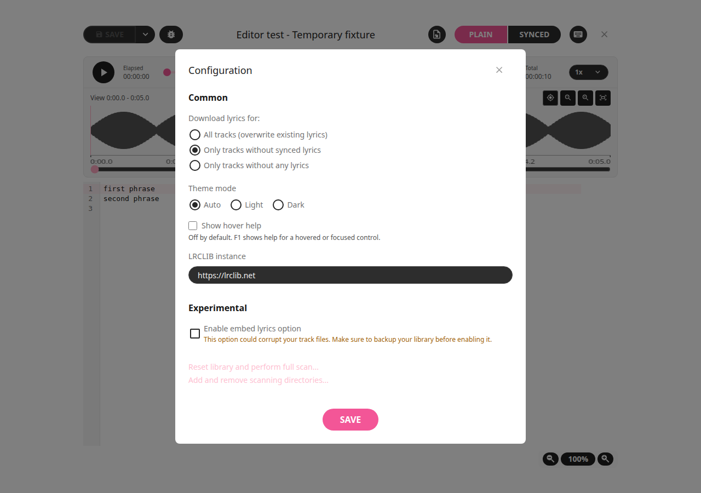
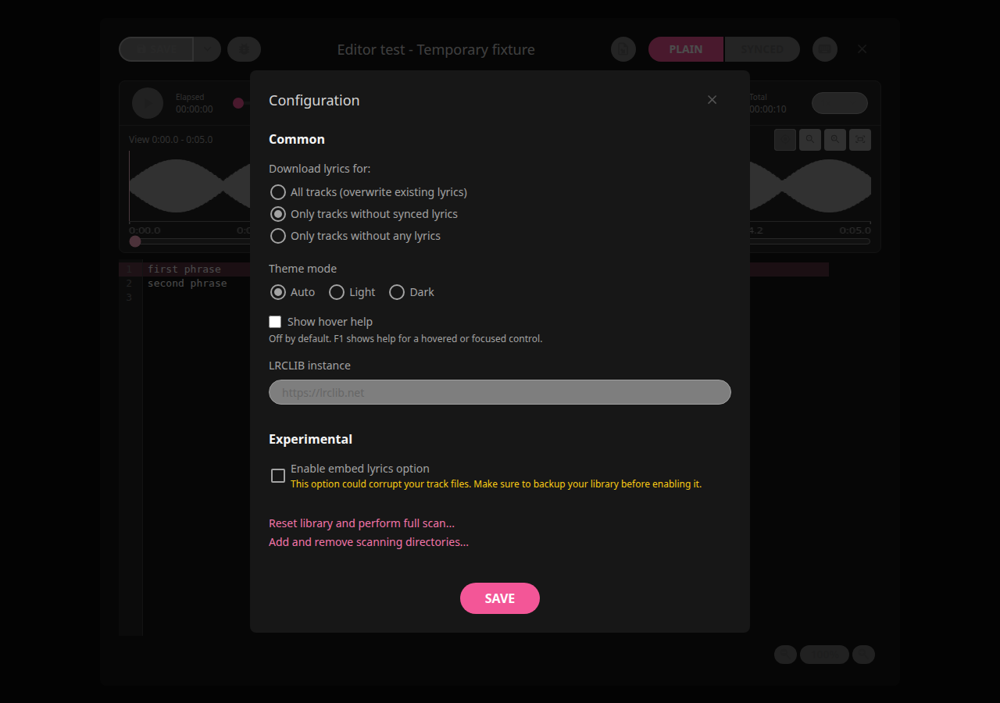

# LRCGET 2.2.4+local.1

Hover help is now optional and **off by default**. Open the library's menu,
choose **Settings**, toggle **Show hover help** in Configuration → Common,
and click **Save**. Your choice is remembered when the app restarts.
Closing Configuration without Save discards the draft. A failed Save keeps the
previous choice, displays a retry message and keeps Configuration open.

With hover help off, pointing at controls stays quiet. Press **F1** over a
control or with keyboard focus on it to request help for two seconds.
With hover help on, pause over a control for one second; the description closes
after two seconds even with the pointer stationary. Existing configured editor
shortcuts retain priority over F1. Turning the setting off cancels pending or
visible help immediately.

Descriptions remain available to assistive technology. The passive, bounded
bubble cannot intercept editing clicks and displays literal text. Leaving,
clicking, scrolling, Escape, window blur, resizing or removing a control dismisses
help. All existing playback, zoom, marker, lyric save and export features remain.




## Verification

389 frontend tests and 57 Rust tests passed; one optional audio-fixture test is
ignored. New database tests cover migration without loss of existing settings or
lyrics, default-off behavior, restart persistence, unrelated preference writes
and transaction rollback. Browser tests cover keyboard use, On/Off, Save,
Cancel, failed Save/retry, restart restoration, help timing, dynamic descriptions,
accessibility and cleanup. Native WebKitGTK checks confirm real Settings saves,
SQLite persistence and restoration after reload using an isolated profile.
Scoped lint, formatting and logic review found no remaining introduced blocking
issues. Ruff reports 11 existing findings in the unchanged Python generator.
Existing compiler/bundle warnings remain. See the [review](../reviews/2.2.4-local.1.md).

## Upgrade

This Linux amd64 Debian package upgrades the existing `lrcget` app with its same
identifier and data location. It requires glibc 2.39+, GTK 3 and WebKitGTK 4.1.
Close LRCGET, verify the checksum and install:

```bash
sha256sum -c LRCGET_2.2.4+local.1_amd64.deb.sha256
sudo apt install ./LRCGET_2.2.4+local.1_amd64.deb
```

Production Debian packaging and checksum verification passed. APT simulation
reports one upgrade from installed 2.2.3, zero new apps and zero removals.
The focused upstream proposal passed 142 frontend and 32 Rust tests.

Read the [how-tos](../how-to.md), [features](../app-overview.md) and
[editing guide](../editing-guide.md). The existing
[upstream proposal](https://github.com/tranxuanthang/lrcget/pull/426) is updated
with this focused change. Other Linux package formats are paused at Rick's request.
