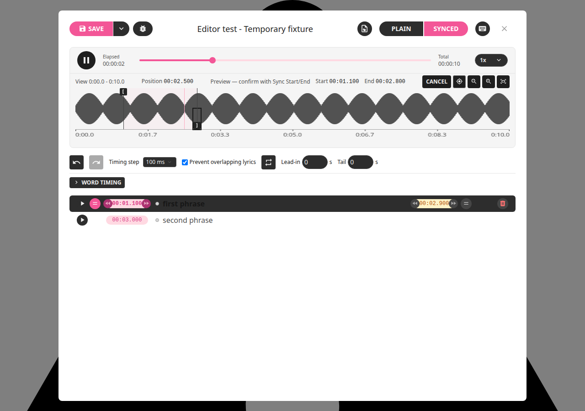
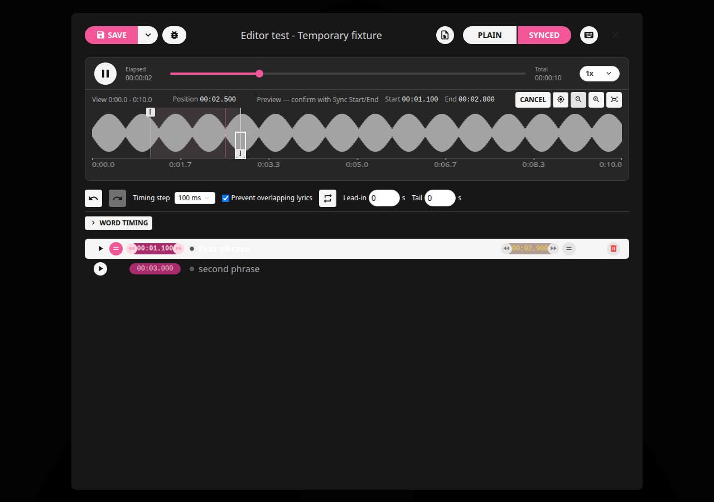
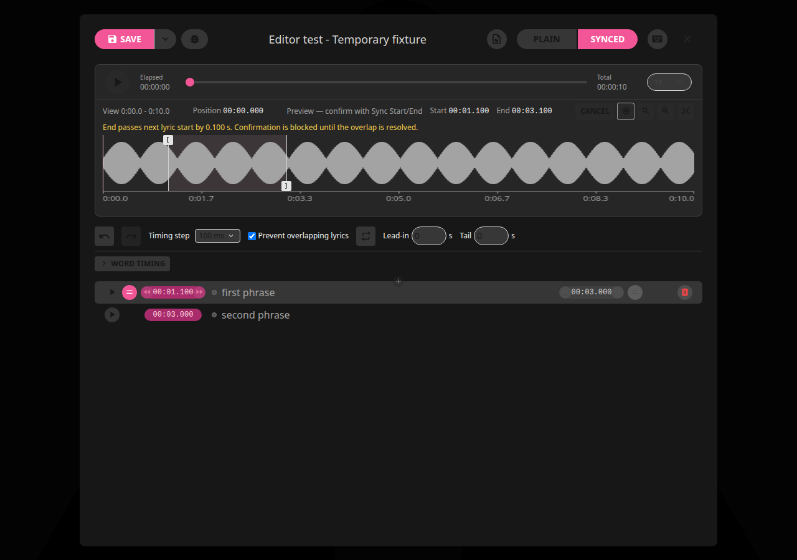

# LRCGET 2.2.6+local.1

Local update only. GitHub publishing and creator notifications remain paused.

Moving a waveform marker previews when the sentence highlight turns on/off,
using the existing colors. Confirm each boundary with **Sync Sentence Start**
or **Sync Sentence End**; **Apply Markers** has been removed. An unchanged marker
uses playback timing instead. Start confirmation preserves a pending end preview,
and vice versa. Cancel restores the latest confirmed timing after any number of
moves. Confirmations remain undoable, and Save persists the confirmed document.

Untimed TXT works with provisional markers without inventing timestamps; confirm
Start before End. **Prevent overlapping lyrics** is on by default for each editor
session. You can preview an overlap, but confirmation is blocked until you correct
it or explicitly turn protection off. Existing overlaps are not silently repaired.
Zoom, double-click navigation and persistent Loop remain supported. Dragging updates
highlighting live; Loop uses released/nudged bounds to avoid drag-induced seek chatter.





## Standard LRC export

A confirmed end before the next sentence becomes a blank timestamped cue when
the gap is at least 250 ms. Shorter gaps are omitted to reduce visible flicker.
Confirmed final ends also receive a cue. Existing timestamps are not duplicated,
and a cue is not inserted while another overlapping sentence remains active.
Untimed sentences remain in saved/plain data and are omitted from synchronized
export. Exact milliseconds are retained in both frontend and backend export.

```lrc
[00:10.000]First sentence
[00:13.000]
[00:15.000]Next sentence
[00:18.000]
```

Reopening LRCGET's saved document restores exact end-marker times. Importing the
LRC alone shows its real blank timed rows and recovers represented gap boundaries;
it cannot recover exact ends for short gaps omitted from that LRC. Player handling
of blank cues varies; this uses standard line timestamps, not proprietary end tags.

## Local installation

The installer upgrades the same amd64 `lrcget` package and app data location.
Requires glibc 2.39+, GTK 3 and WebKitGTK 4.1.

```bash
cd ~/Downloads
sha256sum -c LRCGET_2.2.6+local.1_amd64.deb.sha256
sudo apt install ./LRCGET_2.2.6+local.1_amd64.deb
```

See the [review](../reviews/2.2.6-local.1.md),
[marker how-to](../how-to.md#place-precise-markers-and-preview-before-confirming)
and [editing reference](../editing-guide.md#marker-confirmation-and-lrc-gaps-226).

## Validation

413 frontend tests and 60 Rust tests passed (one optional Rust fixture ignored).
Cargo check, scoped ESLint and production Debian packaging passed. Existing lint
warnings are documented in the review. Browser checks passed for marker preview,
confirmation, Cancel, untimed text, overlap protection and persistent Loop/zoom.
APT simulation confirms one upgrade from 2.2.5, zero new apps and zero removals.
The package identity remains `lrcget`, with identifier `net.lrclib.lrcget`.

The installed package is verified as `2.2.6+local.1`; its installed executable
matches the Debian payload byte for byte. Close and reopen LRCGET to use the
updated interface if an older process is still open.
