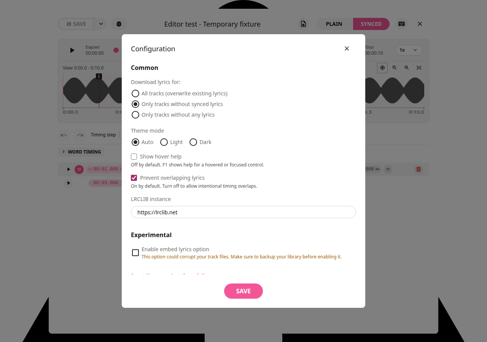
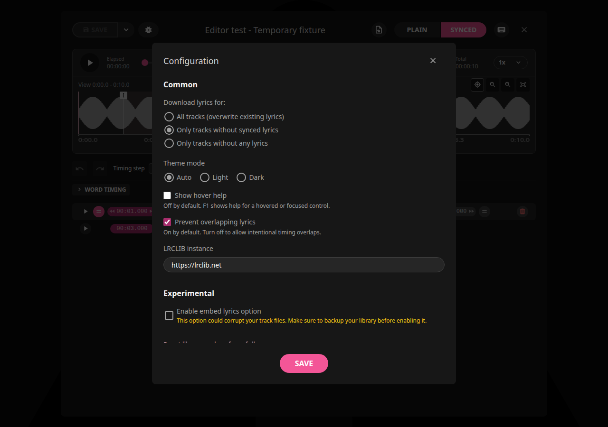
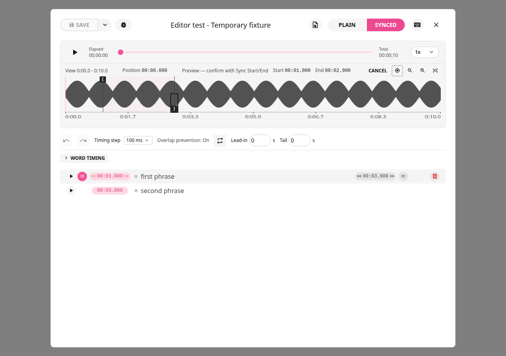
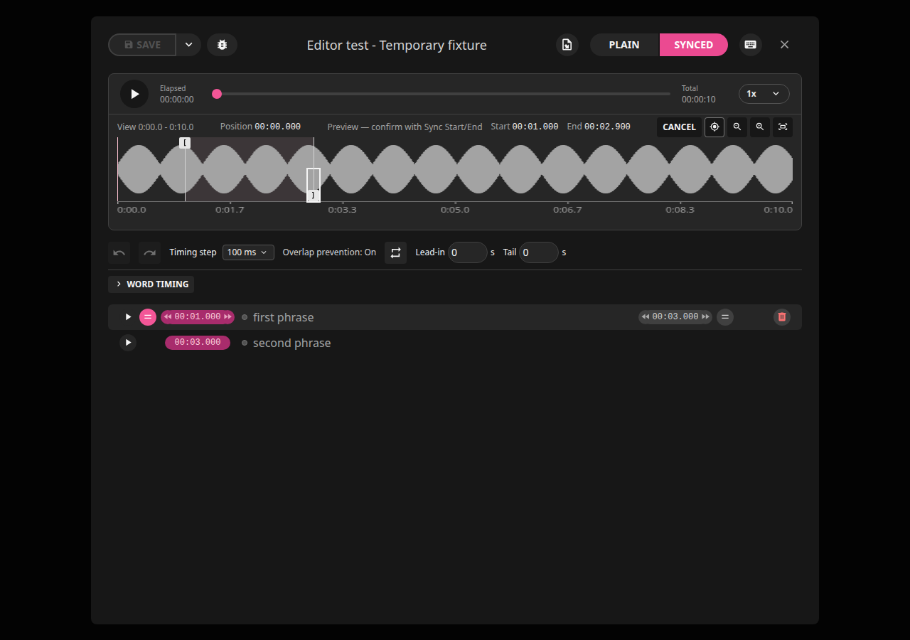
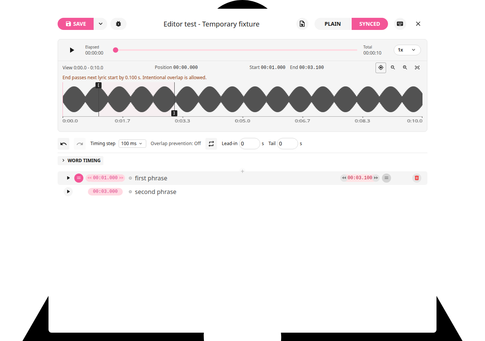

# LRCGET 2.2.6+local.2

Overlap protection is now a saved setting in **Settings → Configuration → Common**.
Check **Prevent overlapping lyrics**, then **Save**, to block overlapping timing
changes. Uncheck and Save to allow intentional overlaps. It defaults on and
survives restarting. Cancel and failed saves leave the active choice unchanged.

The Synced toolbar displays **Overlap prevention: On** or **Overlap prevention: Off**
in place of its previous checkbox. This text cannot toggle protection accidentally
when using the adjacent Loop button. Changing the setting does not rewrite lyrics
or repair existing overlaps. Failed configuration loads block Save to protect
previous settings from being overwritten with defaults.








Marker preview, sentence Sync confirmation, Cancel baselines and standard LRC
export are retained from [local.1](2.2.6-local.1.md). Confirmed gaps of at least
250 ms and final ends use blank timestamped cues; exact ends stay saved internally.

## Checks and installation

414 frontend tests and 63 Rust tests passed (one optional fixture ignored).
Browser checks cover On/Off status, keyboard-accessible Settings, cancellation,
failed saves, failed loads, saved-choice restoration and validation using Off.
Cargo check and scoped ESLint passed; existing warnings are documented in the
[review](../reviews/2.2.6-local.2.md).

The Debian package upgrades the same amd64 `lrcget` app and retains identifier
`net.lrclib.lrcget`. GitHub publication and creator notifications remain paused.
The installer/checksum are available locally in Rick's Downloads folder.

```bash
cd ~/Downloads
sha256sum -c LRCGET_2.2.6+local.2_amd64.deb.sha256
sudo apt install ./LRCGET_2.2.6+local.2_amd64.deb
```
