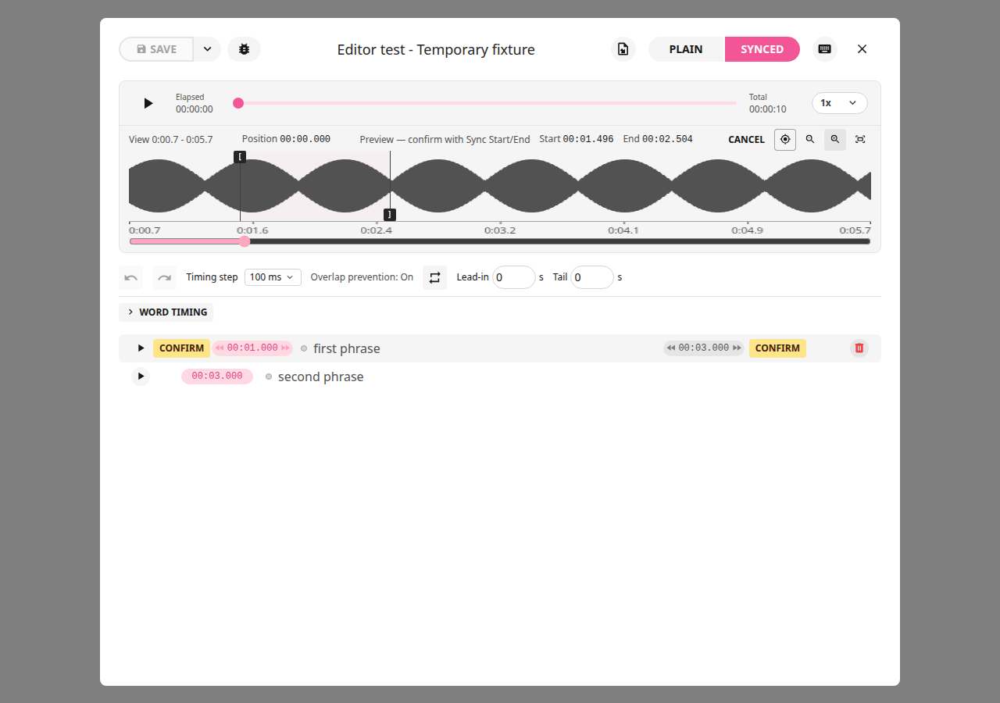
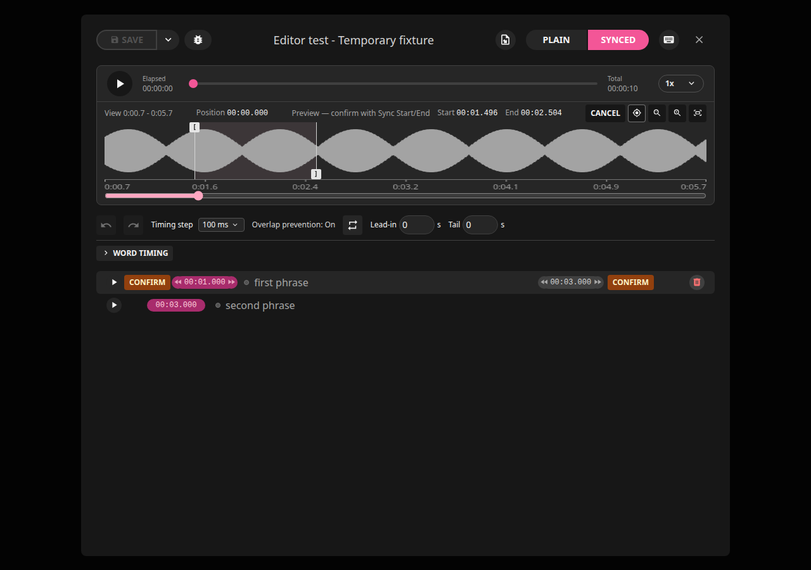
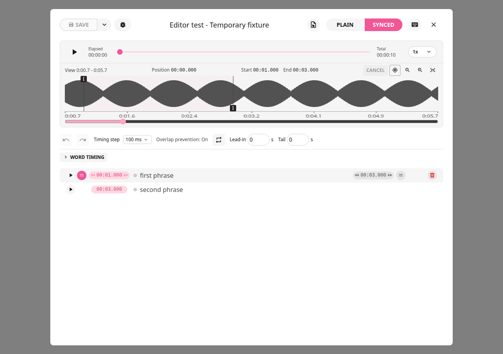
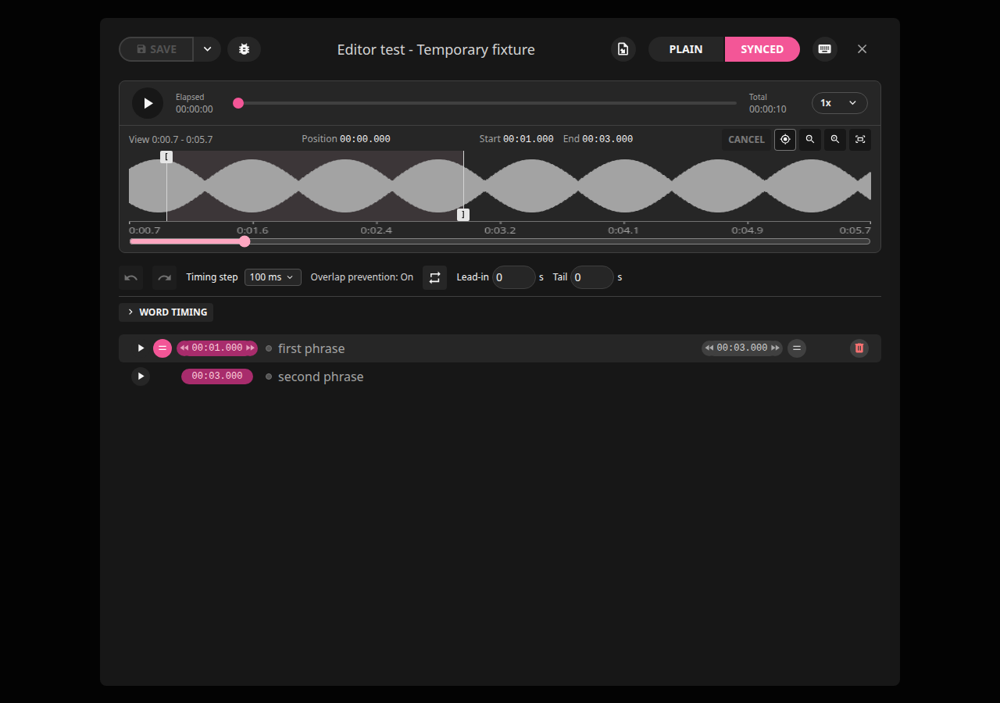
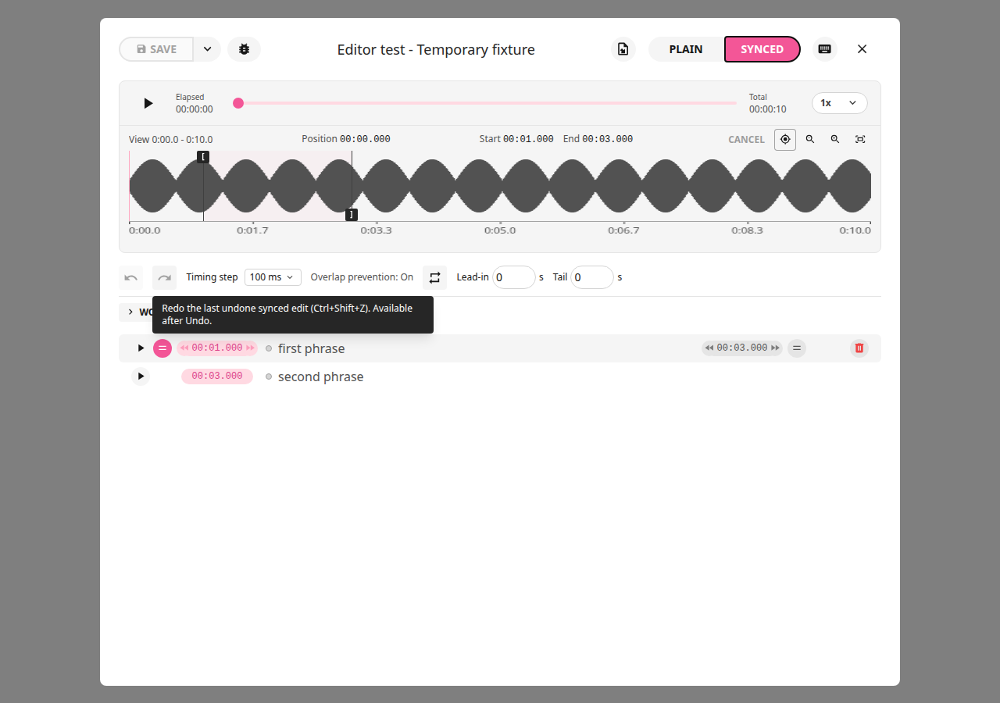
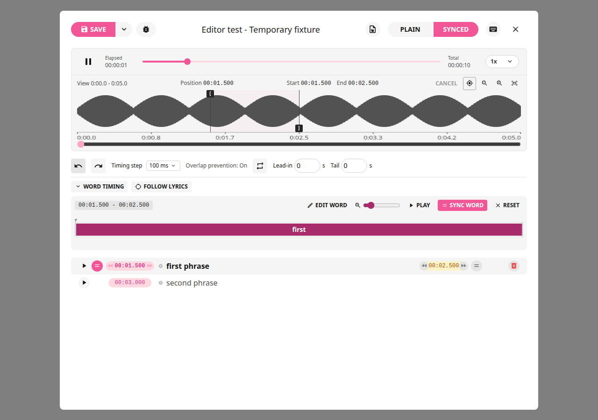
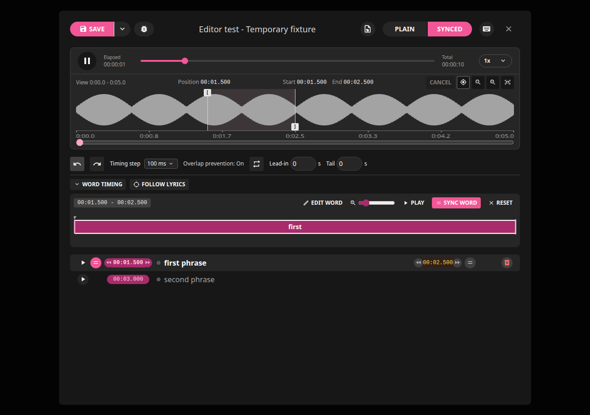

# LRCGET 2.2.6+local.3

Pending waveform marker edits now give the corresponding sentence button an
amber accent and the label **Confirm**. The start button beside Play responds
only to a changed start marker; the end button responds only to a changed end.
Confirming or cancelling restores the ordinary appearance. With no pending edit
for that boundary, the button keeps its original icon, color and playback-timing
behavior. Sentence text keeps its normal colors.

**Cancel** stays visible beside the waveform Start/End times. It is enabled after
an unconfirmed marker movement is released, and disabled when nothing is pending
or while dragging. It restores both markers to the last confirmed timing, even
after repeated dragging, nudging and zooming. If Start has already been confirmed,
Cancel keeps that confirmed Start and discards only the remaining preview.

**Undo** reverses confirmed changes; **Redo** reapplies an undone change. Their F1
help now explains this distinction and that Cancel discards unconfirmed markers.
Help resolves hovered disabled controls and supports desktop webviews delivering
only the F1 release. Normal presses show one bubble, which closes after two seconds;
shortcuts that consume F1 keep priority. Automatic hover help remains optional.

Word Timing no longer repeats the sentence beside its time range. Editable word
boxes and the sentence in the lyric list remain available.







Saved overlap protection and LRC gap handling are retained from
[local.2](2.2.6-local.2.md) and [local.1](2.2.6-local.1.md).

## Verification and local upgrade

415 frontend tests passed, including repeated marker edits and Cancel after zoom.
Actual browser checks cover repeated drags/nudges, independent Confirm buttons,
restored colors, partial confirmation, direct playback Sync, disabled Redo help,
F1 release fallback, shortcut priority and timed dismissal. Cargo check and the
Debian build passed. See the [review](../reviews/2.2.6-local.3.md) for limitations
and existing lint findings.

This package upgrades the same amd64 `lrcget` installation and preserves
`net.lrclib.lrcget` and its data location. GitHub publication and creator
notifications remain paused. Source, docs, screenshots, package and checksum
are maintained in local Git and Rick's existing local Git server.

```bash
cd ~/Downloads
sha256sum -c LRCGET_2.2.6+local.3_amd64.deb.sha256
sudo apt install ./LRCGET_2.2.6+local.3_amd64.deb
```




Browser checks also verify both generated word boxes retain the full sentence,
boundary dragging changes adjacent durations, and Undo restores their timing.
