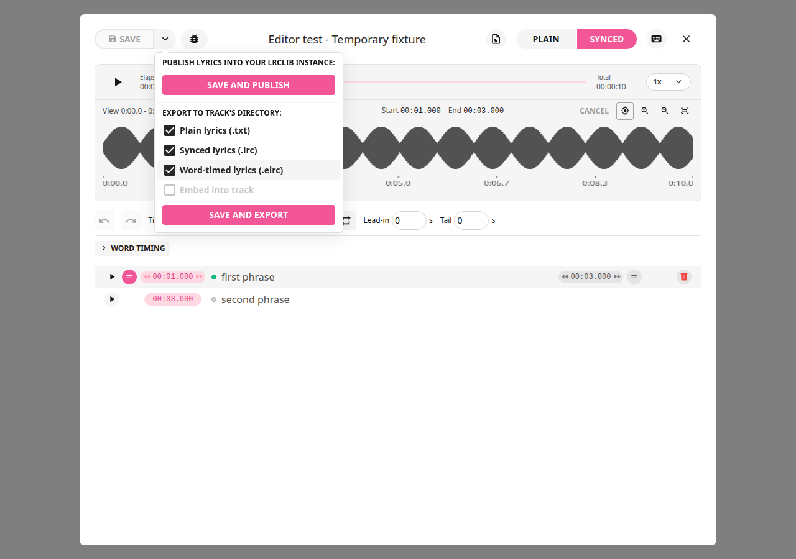
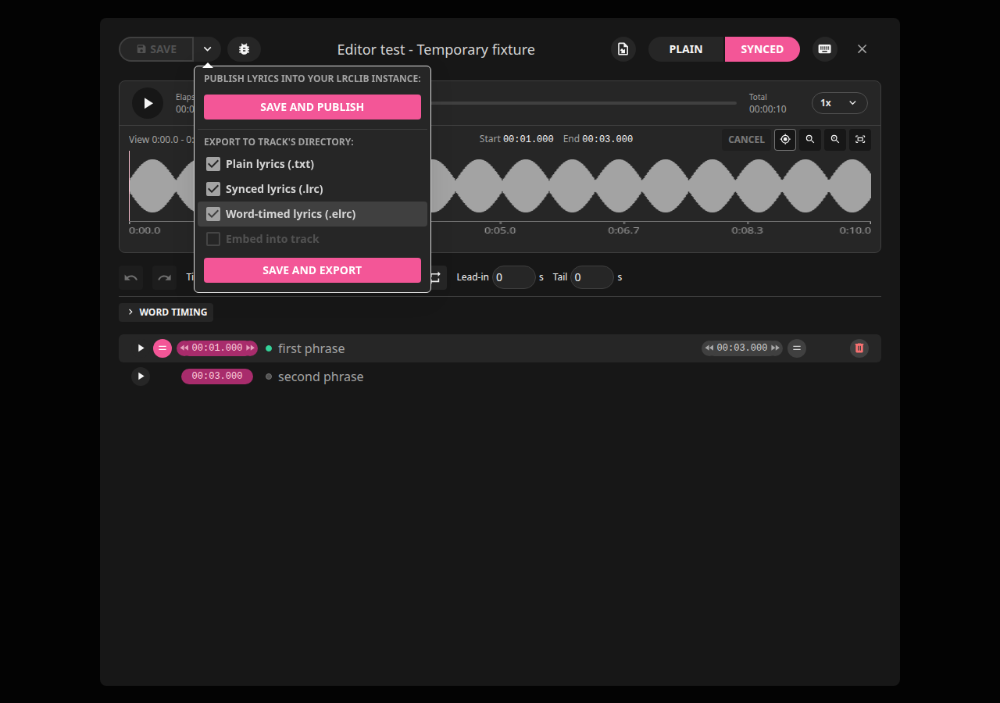
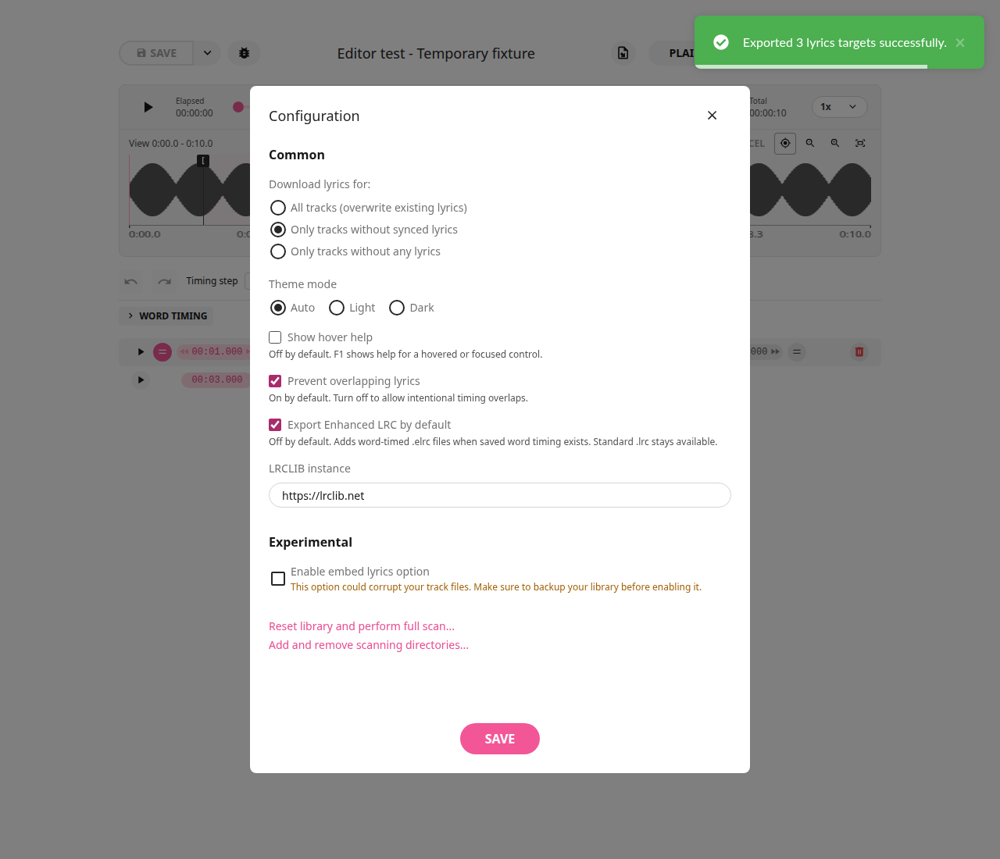

# LRCGET 2.2.6+local.5

Optional Enhanced LRC export now saves `Song.elrc` alongside independent
`Song.txt` and standard `Song.lrc` files. Select **Word-timed lyrics (.elrc)** in
the editor export menu, batch Export or Download auto-export. Enable
**Configuration → Common → Export Enhanced LRC by default** to remember the
choice. It is off by default; selected standard exports remain available.

Saved valid word starts/ends use millisecond inline tags. Known word silence and
existing sentence gap cues are retained. Mixed line-only rows stay line-timed.
Missing word timing skips ELRC; malformed timing fails only that format and leaves
an older ELRC untouched. Other selected exports still run. No automatic singing
analysis, ELRC import or Jellyfin web karaoke modification is included.





See the [illustrated how-to](../how-to.md#export-word-timing-as-enhanced-lrc) and
[code review](../reviews/2.2.6-local.5.md). Verification: 418 frontend tests and
70 Rust tests pass (one existing ignored audio-fixture test). Browser checks cover
all-three export selection, the saved word snapshot, saved default, editor reopen
and manual selection retention. Cargo check and production packaging pass.

The same amd64 `lrcget` package upgrades in place with the existing identifier and
data directory. Source, docs, screenshots, installer and checksum are kept in
local Git and Rick's local Git server. GitHub publishing remains paused.

```bash
cd ~/Downloads
sha256sum -c LRCGET_2.2.6+local.5_amd64.deb.sha256
sudo apt install ./LRCGET_2.2.6+local.5_amd64.deb
```
