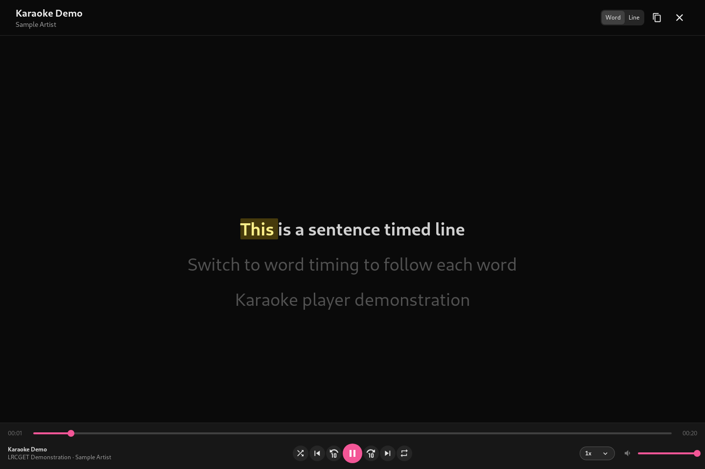
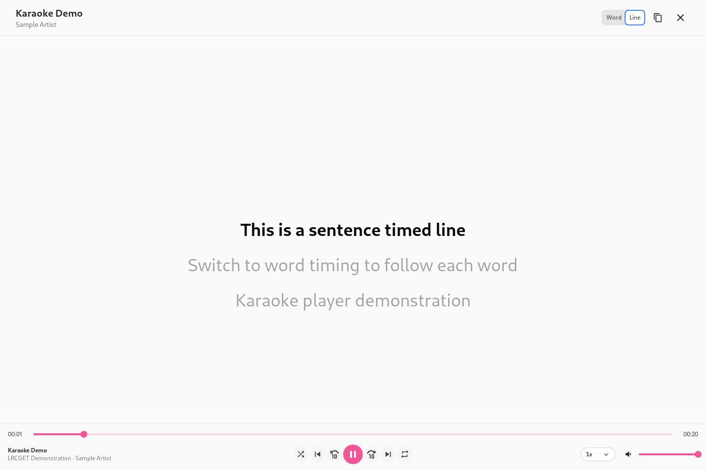

# LRCGET 2.3.0

This release adds a karaoke display that plays timed lyrics from valid LRC and
ELRC sidecars in the music library.

## Karaoke playback

- A square lyrics icon opens karaoke for tracks with valid timed `.lrc` or
  `.elrc` sidecars. It is disabled when no usable timed sidecar exists.
- When both formats are available, switch between sentence timing (LRC) and word
  timing (ELRC). If only one is available, no redundant format switch is shown.
- The karaoke screen uses the same bottom playback controls as the library.
- Opening karaoke for the currently playing song preserves its position and
  paused/running state. Closing the screen returns to the library while playback
  continues.
- Previous, Next, Shuffle and Repeat skip queue tracks without usable timed
  lyrics. Playback does not restart or select an ineligible track during this
  navigation.
- The view reads sidecars and does not edit, create or upload lyric files.

## Documentation and validation

See [the karaoke how-to](../how-to.md#play-a-song-with-karaoke-lyrics),
[feature overview](../app-overview.md#karaoke-display), and
[package guide](../packages.md) for instructions, screenshots and platform
limitations. Package workflow results will be recorded after the final 2.3.0
release commit passes the Windows MSI and Linux DEB/AppImage workflows.
